# EduNest — ফিচার ডকুমেন্টেশন

**Multi-Vendor School Management SaaS** · Django 5 · shared-database multi-tenancy

> 🌐 English version: [FEATURES.md](FEATURES.md) · 📄 PDF: [EduNest-Documentation-BN.pdf](EduNest-Documentation-BN.pdf)

EduNest একটি "Shopify for Schools" প্ল্যাটফর্ম। একটি deployment একসাথে অনেক স্কুলকে সেবা
দেয়। প্রতিটি স্কুল একটি আলাদা **tenant** — নিজস্ব সাবডোমেইন, ব্র্যান্ডিং, ইউজার ও ডেটা নিয়ে
সম্পূর্ণ পৃথক — আর প্ল্যাটফর্ম মালিক (Super Admin) একটিমাত্র কনসোল থেকে সব tenant পরিচালনা
করেন।

এই ডকুমেন্টে **বর্তমানে বাস্তবায়িত প্রতিটি ফিচার** স্ক্রিন-বাই-স্ক্রিন তুলে ধরা হয়েছে, চালু
অ্যাপ্লিকেশন থেকে নেওয়া স্ক্রিনশটসহ।

---

## সূচিপত্র

1. [প্ল্যাটফর্ম এক নজরে](#১-প্ল্যাটফর্ম-এক-নজরে)
2. [আর্কিটেকচার ও মাল্টি-টেন্যান্সি](#২-আর্কিটেকচার-ও-মাল্টি-টেন্যান্সি)
3. [রোল ও অ্যাক্সেস কন্ট্রোল](#৩-রোল-ও-অ্যাক্সেস-কন্ট্রোল)
4. [পাবলিক ওয়েবসাইট](#৪-পাবলিক-ওয়েবসাইট)
5. [অনলাইন ভর্তি](#৫-অনলাইন-ভর্তি)
6. [Super Admin কনসোল](#৬-super-admin-কনসোল)
7. [School Admin — সেটআপ ও অ্যাকাডেমিকস](#৭-school-admin--সেটআপ-ও-অ্যাকাডেমিকস)
8. [School Admin — স্টাফ ব্যবস্থাপনা](#৮-school-admin--স্টাফ-ব্যবস্থাপনা)
9. [School Admin — শিক্ষার্থী ব্যবস্থাপনা](#৯-school-admin--শিক্ষার্থী-ব্যবস্থাপনা)
10. [ক্লাসরুম (Google-Classroom স্টাইল)](#১০-ক্লাসরুম-google-classroom-স্টাইল)
11. [পরীক্ষা ও ফলাফল](#১১-পরীক্ষা-ও-ফলাফল)
12. [উপস্থিতি (ম্যানুয়াল + বায়োমেট্রিক)](#১২-উপস্থিতি-ম্যানুয়াল--বায়োমেট্রিক)
13. [ফি, ইনভয়েস ও পেমেন্ট](#১৩-ফি-ইনভয়েস-ও-পেমেন্ট)
14. [শিক্ষক রেটিং সিস্টেম](#১৪-শিক্ষক-রেটিং-সিস্টেম)
15. [সার্টিফিকেট ও প্রিন্টযোগ্য ডকুমেন্ট](#১৫-সার্টিফিকেট-ও-প্রিন্টযোগ্য-ডকুমেন্ট)
16. [নোটিফিকেশন ও সেটিংস](#১৬-নোটিফিকেশন-ও-সেটিংস)
17. [শিক্ষক ওয়ার্কস্পেস](#১৭-শিক্ষক-ওয়ার্কস্পেস)
18. [শিক্ষার্থী পোর্টাল](#১৮-শিক্ষার্থী-পোর্টাল)
19. [অভিভাবক পোর্টাল](#১৯-অভিভাবক-পোর্টাল)
20. [বায়োমেট্রিক ডিভাইস API](#২০-বায়োমেট্রিক-ডিভাইস-api)
21. [ডেটা মডেল রেফারেন্স](#২১-ডেটা-মডেল-রেফারেন্স)
22. [সিকিউরিটি মডেল](#২২-সিকিউরিটি-মডেল)
23. [টেক স্ট্যাক ও ডিপ্লয়মেন্ট](#২৩-টেক-স্ট্যাক-ও-ডিপ্লয়মেন্ট)
24. [ডেমো চালানো](#২৪-ডেমো-চালানো)
25. [বাস্তবায়িত বনাম স্ক্যাফোল্ডেড](#২৫-বাস্তবায়িত-বনাম-স্ক্যাফোল্ডেড)

---

## ১. প্ল্যাটফর্ম এক নজরে

| | |
|---|---|
| **প্রোডাক্ট** | EduNest — multi-tenant school management SaaS |
| **টেন্যান্সি মডেল** | Shared database, shared schema, প্রতিটি tenant row-এ `school` FK |
| **টেন্যান্ট রেজলিউশন** | সাবডোমেইন (`greenvalley.platform.local`) অথবা Premium custom domain |
| **রোল** | ৯টি (Super Admin, School Admin, Sub-Admin, Teacher, Accountant, Student, Parent, Librarian, Transport Manager) |
| **ফিচার মডিউল** | ১২টি Django app |
| **ডকুমেন্টেড স্ক্রিন** | ৭৫টি |
| **প্রাইসিং মডেল** | প্রতি শিক্ষার্থী ফ্ল্যাট ৳১০, অফলাইনে বিল; Super Admin ম্যানুয়ালি প্রোভিশন করেন |
| **ব্যাকএন্ড** | Django 5.0, DRF 3.15, Celery 5.4 (কনফিগার্ড), SQLite (dev) / Postgres / MySQL |
| **ফ্রন্টএন্ড** | Server-rendered Django templates + Tailwind, প্রিন্ট-অপটিমাইজড রিপোর্ট পেজ |

### ১২টি ফিচার মডিউল

| App | দায়িত্ব |
|---|---|
| `core` | Abstract base model, tenant-scoped ORM manager, tenant middleware |
| `tenants` | `School` (tenant), `SubscriptionPlan`, `ContactMessage` সেলস লিড |
| `accounts` | রোল-ভিত্তিক অ্যাক্সেস কন্ট্রোলসহ কাস্টম `User` |
| `academics` | অ্যাকাডেমিক ইয়ার, ক্লাস, সেকশন, বিষয়, সাপ্তাহিক ক্লাস রুটিন |
| `teachers` | পদবি (Designation), শিক্ষক প্রোফাইল, পদবির ইতিহাস |
| `students` | শিক্ষার্থী, অভিভাবক, ভর্তির আবেদন, ট্রান্সফার, সার্টিফিকেট |
| `rooms` | সহযোগিতামূলক ক্লাসরুম: ফিড, নোট, অ্যাসাইনমেন্ট, সাবমিশন |
| `fees` | ফি টাইপ, ফি স্ট্রাকচার, ডিসকাউন্ট, ইনভয়েস, পেমেন্ট, ইনভয়েস ডিজাইন |
| `ratings` | রেটিং পিরিয়ড, বেনামি শিক্ষক রেটিং, অ্যাগ্রিগেট, লিডারবোর্ড |
| `attendance` | শিক্ষার্থী/স্টাফ উপস্থিতি, ছুটি, বায়োমেট্রিক এনরোলমেন্ট ও পাঞ্চ |
| `exams` | পরীক্ষার সেশন, পরীক্ষার বিষয়, ফলাফল |
| `notifications` | SMS / push / email / in-app নোটিফিকেশন লগ |

---

## ২. আর্কিটেকচার ও মাল্টি-টেন্যান্সি

প্রতিটি tenant-মালিকানাধীন টেবিলে একটি `school` foreign key থাকে। আইসোলেশন চারটি লেয়ারে
প্রয়োগ করা হয়, তাই একটিমাত্র ফিল্টার বাদ পড়লেও এক স্কুলের ডেটা অন্য স্কুলে ফাঁস হতে পারে না।

```
Request  ─►  TenantMiddleware                      tenant শনাক্ত করে
             ├─ host শেষ হয় PLATFORM_DOMAIN দিয়ে ─► সাবডোমেইন label → School.slug
             ├─ অন্যথায় ────────────────────────►  School.custom_domain (Premium)
             └─ authenticated non-super-admin ──►  সবসময় user.school-এ pinned
                                                   (সাবডোমেইন override করতে পারে না)
                  │
                  ▼
             thread-local current school  ─►  SchoolScopedManager.get_queryset()
                                              প্রতিটি ORM কল auto-filter করে
                  │
                  ▼
             TenantQuerysetMixin (list/detail)  +  TenantModelForm (FK dropdowns)
```

মূল কম্পোনেন্ট:

| কম্পোনেন্ট | ফাইল | কাজ |
|---|---|---|
| `SchoolScopedModel` | [apps/core/models.py](../apps/core/models.py) | Abstract base: `school` FK, `objects` (scoped) ও `all_objects` (raw) manager |
| `SchoolScopedManager` | [apps/core/managers.py](../apps/core/managers.py) | thread-local tenant দিয়ে queryset auto-filter; `.unscoped()` দিয়ে বাইপাস |
| `TenantMiddleware` | [apps/core/middleware.py](../apps/core/middleware.py) | host থেকে tenant শনাক্ত, কর্মীদের নিজ স্কুলে pin করে |
| `scope_to(school)` | [apps/core/tenant.py](../apps/core/tenant.py) | Celery task / shell / management command-এর জন্য context manager |
| `TenantQuerysetMixin` | [apps/web/mixins.py](../apps/web/mixins.py) | list ও detail view-তে অতিরিক্ত সুরক্ষা হিসেবে পুনরায় filter |
| `TenantModelForm` | [apps/web/forms.py](../apps/web/forms.py) | প্রতিটি FK/M2M dropdown বর্তমান tenant-এ scope করে |

সংরক্ষিত সাবডোমেইন (`www`, `app`, `admin`, `api`, `static`, `media`) এবং খালি প্ল্যাটফর্ম
ডোমেইন-এ **কোনো** tenant থাকে না — এগুলো মার্কেটিং সাইট ও Super Admin কনসোল সার্ভ করে।

### CRUD স্ক্যাফোল্ডিং

Admin-পরিচালিত মডেলগুলো একটি জেনারেটেড CRUD stack শেয়ার করে, তাই প্রতিটি list পেজ একই
search, filter, pagination ও action বিনামূল্যে পায়:

- [apps/web/views/crud_views.py](../apps/web/views/crud_views.py)-এর `crud()` factory একটি
  মডেলের জন্য `(List, Create, Update, Delete)` ক্লাস রিটার্ন করে।
- [apps/web/urls.py](../apps/web/urls.py)-এর `crud_paths()` সেগুলোকে চারটি সামঞ্জস্যপূর্ণ
  নামের URL pattern-এ রূপান্তর করে (`<base>_list`, `_create`, `_edit`, `_delete`)।
- [apps/web/views/base.py](../apps/web/views/base.py)-এর base view ঘোষিত ফিল্ডের উপর `?q=`
  search, dropdown filter, query-param সংরক্ষণকারী 25-per-page pagination এবং role gating
  যোগ করে।

এই factory দিয়ে তৈরি মডেল: Academic Years, Classes, Sections, Subjects, Designations,
Teachers, Students, Classrooms, Fee Types, Fee Structures, Rating Periods, Biometric
Enrollments, Exam Sessions।

---

## ৩. রোল ও অ্যাক্সেস কন্ট্রোল

কাস্টম `User` মডেলে ৯টি রোল সংজ্ঞায়িত। Super Admin ছাড়া প্রতিটি ইউজার ঠিক একটি স্কুলের সাথে যুক্ত।

| রোল | পরিধি | অ্যাক্সেস |
|---|---|---|
| **Super Admin** | প্ল্যাটফর্ম | সব স্কুল, লিড, প্ল্যান; যেকোনো tenant-এ "ঢুকে" তার admin হিসেবে কাজ করতে পারেন |
| **School Admin** | এক স্কুল | নিজ স্কুলের সবকিছু |
| **Sub-Admin** (সহকারী প্রধান) | এক স্কুল | School Admin-এর সমান |
| **Teacher** | এক স্কুল | নিজ ক্লাসরুম, অ্যাসাইনমেন্ট, মার্কস এন্ট্রি, নিজের রেটিং, উপস্থিতি |
| **Accountant** | এক স্কুল | ইনভয়েস, পেমেন্ট, রসিদ, শিক্ষার্থী/ফি রিড অ্যাক্সেস |
| **Student** | এক স্কুল | নিজ ক্লাসরুম, অ্যাসাইনমেন্ট, ফলাফল, ইনভয়েস, শিক্ষক রেটিং |
| **Parent/অভিভাবক** | এক স্কুল | যুক্ত সন্তানের উপস্থিতি, ফলাফল, ইনভয়েস |
| **Librarian** | এক স্কুল | রোল সংজ্ঞায়িত; এখনো ডেডিকেটেড স্ক্রিন নেই |
| **Transport Manager** | এক স্কুল | রোল সংজ্ঞায়িত; এখনো ডেডিকেটেড স্ক্রিন নেই |

প্রয়োগ:

- Class-based view — `SchoolAdminMixin` / `RoleRequiredMixin` `PermissionDenied` raise করে।
- Function-based view — `_require(request, roles)` গার্ড।
- ডিজাইন অনুযায়ী Super Admin per-role গেট বাইপাস করে (প্ল্যাটফর্ম-ব্যাপী সাপোর্ট অ্যাক্সেস)।
- মালিকানা গুরুত্বপূর্ণ যেখানে সেখানে object-লেভেল চেক, যেমন `_can_view_invoice()` — শিক্ষার্থী
  শুধু নিজের ইনভয়েস আর অভিভাবক শুধু নিজ সন্তানেরটি দেখতে পায়।

### সাইন ইন

সব রোলের জন্য একটিমাত্র লগইন ফর্ম; authentication-এর পর dashboard router প্রতিটি ইউজারকে সঠিক
হোম পেজে পাঠায়।

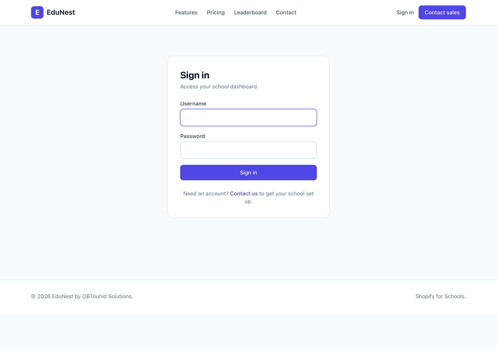

---

## ৪. পাবলিক ওয়েবসাইট

খালি প্ল্যাটফর্ম ডোমেইনে সার্ভ হওয়া unauthenticated মার্কেটিং সাইট।

### হোম / ল্যান্ডিং

ভ্যালু প্রপোজিশন, ফিচার হাইলাইট, প্রতি শিক্ষার্থী প্রাইসিং এবং একটি Contact CTA।

**URL:** `/`

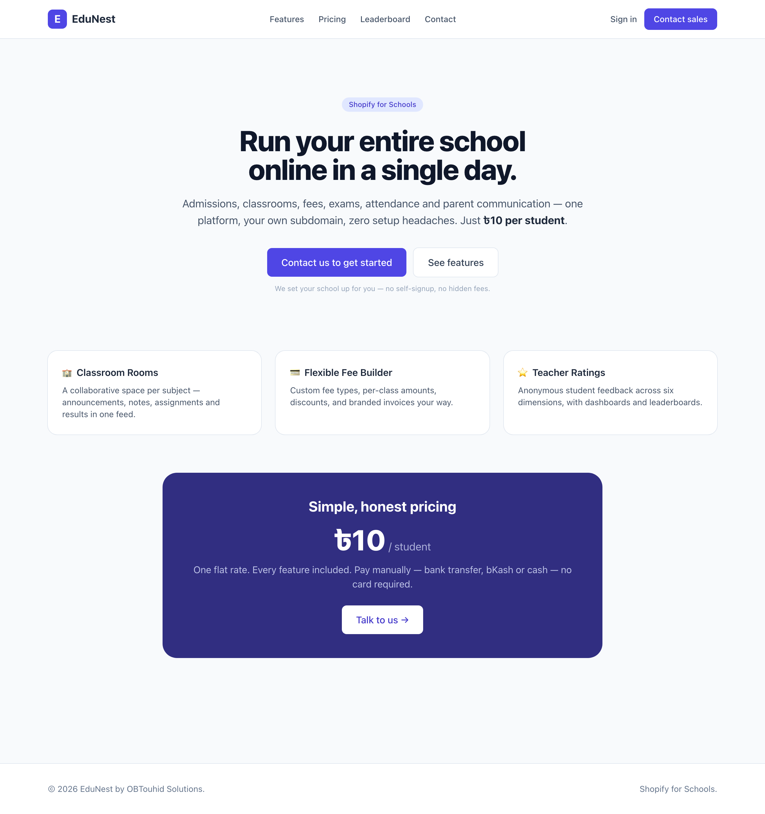

### ফিচার

প্রতিটি স্কুলের জন্য উপলব্ধ প্ল্যাটফর্ম মডিউলগুলোর গ্রিড।

**URL:** `/features/`

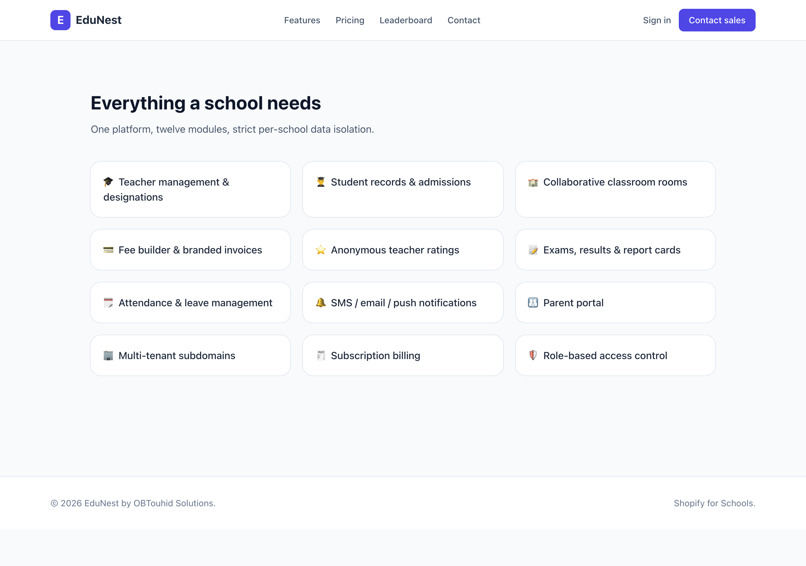

### প্রাইসিং

ফ্ল্যাট প্রাইসিং — প্রতি শিক্ষার্থী ৳১০, অফলাইনে পরিশোধ — একটি inclusion তালিকাসহ। কোনো
self-service checkout নেই: স্কুল অনুসন্ধান করে, আর Super Admin ম্যানুয়ালি প্রোভিশন করেন।

**URL:** `/pricing/`

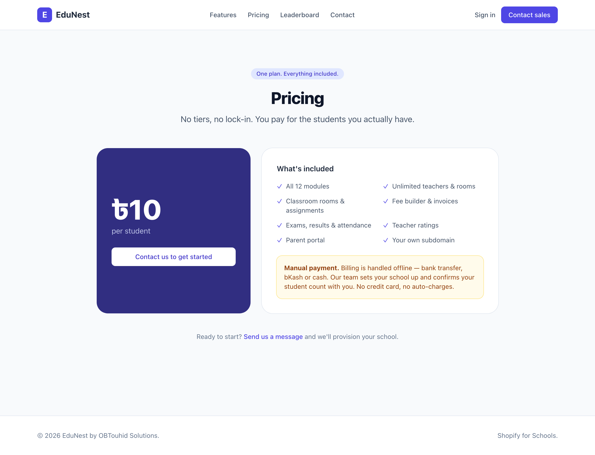

### সেরা শিক্ষক লিডারবোর্ড

**সব স্কুল মিলিয়ে** সেরা-রেটেড শিক্ষকদের প্ল্যাটফর্ম-ব্যাপী র‍্যাঙ্কিং। একজন শিক্ষক অন্তত
**৫টি রেটিং** পাওয়ার পরই তালিকায় আসেন (`MIN_RATINGS_TO_PUBLISH`), যা একটিমাত্র রেটিংকে
তালিকার শীর্ষে ওঠা থেকে ঠেকায়। গড় ওভারঅল স্কোর, তারপর সংখ্যা দিয়ে র‍্যাঙ্ক।

**URL:** `/leaderboard/`

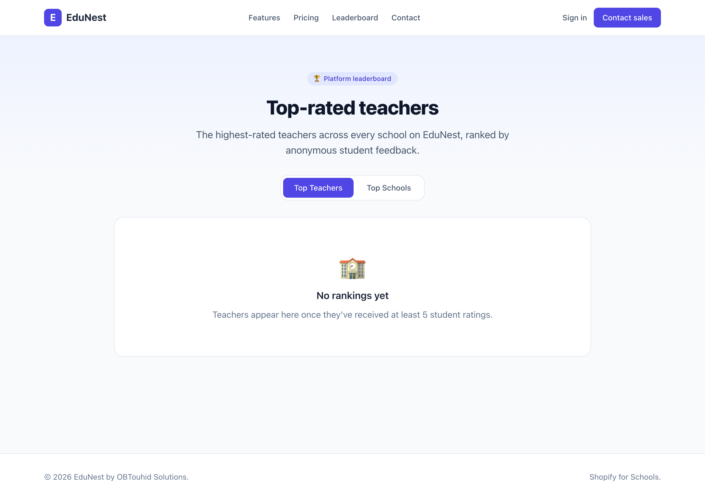

### সেরা স্কুল লিডারবোর্ড

একই ধারণা এক ধাপ উপরে: স্কুলগুলো তাদের শিক্ষকদের রেটিংয়ের গড় দিয়ে র‍্যাঙ্কড। Suspended ও
Cancelled tenant বাদ।

**URL:** `/schools-leaderboard/`

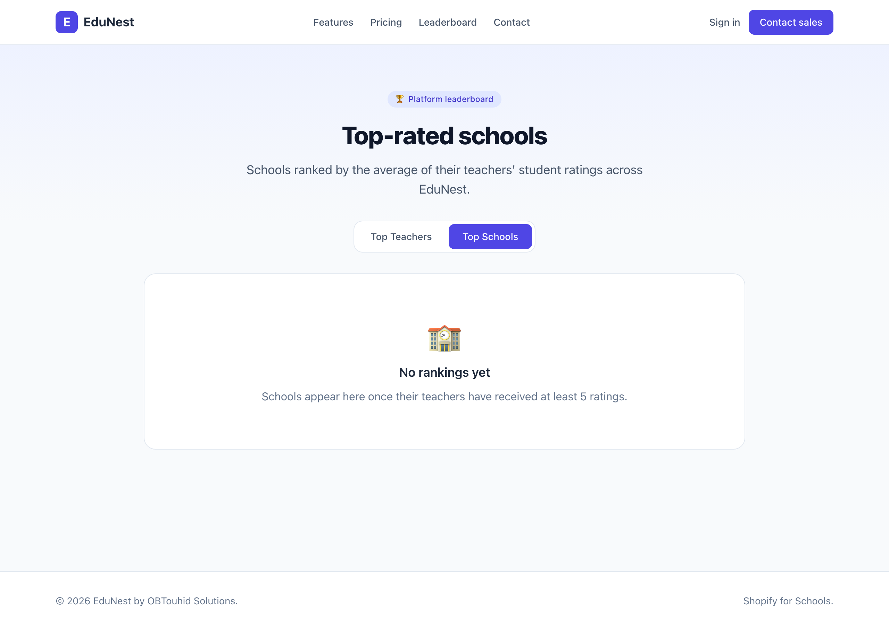

### Contact / সেলস অনুসন্ধান

সাবমিশনগুলো Super Admin ইনবক্সে `ContactMessage` লিড হিসেবে জমা হয়, এবং এক ক্লিকে
প্রোভিশন করা স্কুলে রূপান্তর করা যায়।

**URL:** `/contact/`

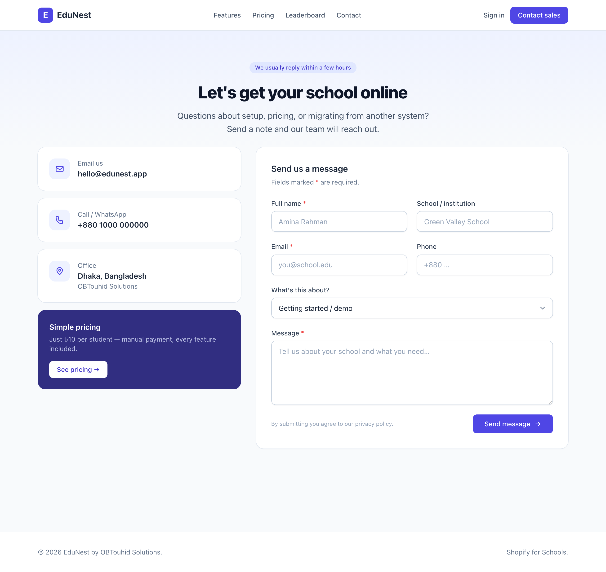

---

## ৫. অনলাইন ভর্তি

একটি সম্পূর্ণ public-থেকে-enrolled ভর্তি পাইপলাইন, যা মার্কেটিং সাইট ও স্কুল admin কনসোল
জুড়ে বিস্তৃত।

```
আবেদনকারী                          School Admin
────────────────────────────────   ───────────────────────────────────
/admissions/ ব্রাউজ করে
  │
  ├─ কোনো স্কুলে আবেদন ──────────► আবেদন "Pending" হিসেবে জমা হয়
  │   tracking code পায়                 │
  │   + token URL + admit card          ├─ Approve → class/section/roll বাছাই
  │                                     │            → Student তৈরি হয়
  ├─ যেকোনো সময় status ট্র্যাক ◄─────────┤            → Guardian তৈরি হয়
  │                                     └─ Reject  → কারণ রেকর্ড হয়
  └─ admit card প্রিন্ট করে
```

### ভর্তি ডিরেক্টরি

বর্তমানে অনলাইন আবেদন গ্রহণকারী (`admissions_open = True`, এবং suspended/cancelled নয়)
প্রতিটি স্কুলের পাবলিক, searchable তালিকা।

**URL:** `/admissions/`

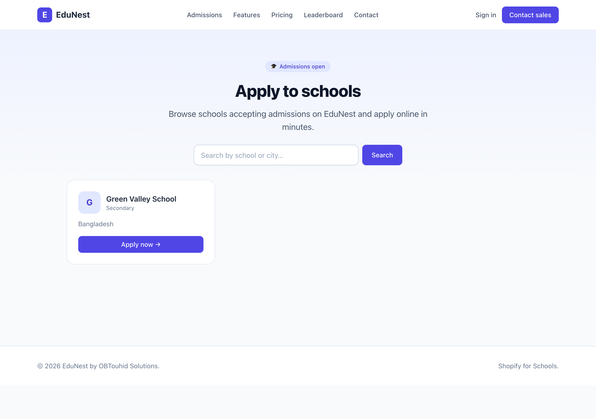

### অনলাইন আবেদন ফর্ম

স্কুলের নিজস্ব পাবলিক ফর্ম। "class applying for" ফিল্ডটি স্কুলের প্রকৃত ক্লাস তালিকা থেকে
পূরণ হয় যদি সেটি থাকে। সাবমিটে আবেদনকারী একটি **tracking code** (যেমন `DEMO-2026-0001`) এবং
একটি অনুমান-অসম্ভব ২৪-অক্ষরের **track token** পায়।

স্কুল চাইলে **PDF মোড**-এ পরিবর্তন করতে পারে, যেখানে পেজটি অনলাইন ফর্মের বদলে ডাউনলোডযোগ্য
প্রিন্টযোগ্য ফর্ম ও নির্দেশনা সার্ভ করে।

**URL:** `/admissions/<school-slug>/apply/`

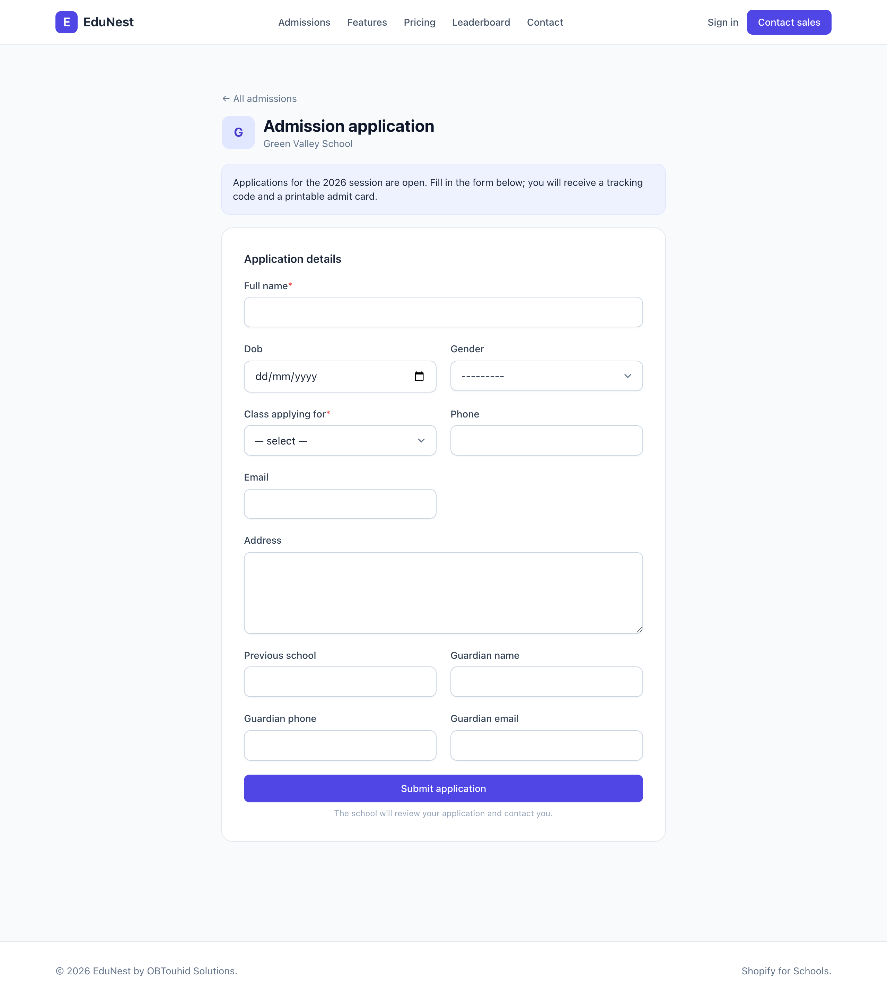

### আবেদন ট্র্যাক

token দিয়ে পৌঁছানো পাবলিক status পেজ — কোনো লগইন লাগে না, এবং enumerate করা যায় না।

**URL:** `/admissions/track/<token>/`

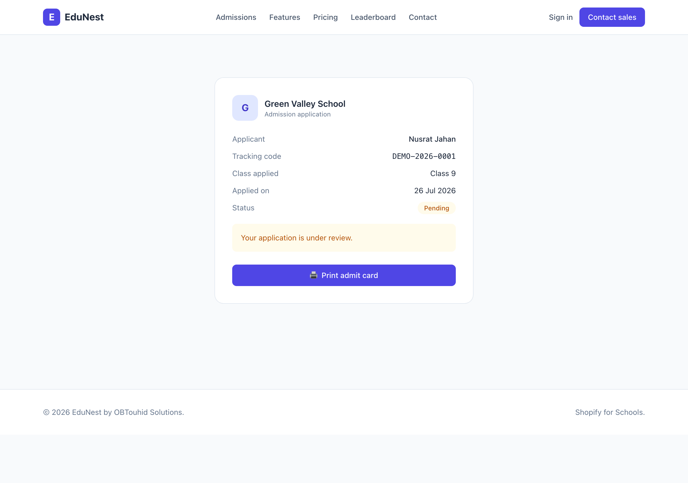

### Admit card

আবেদনকারীকে ইস্যু করা প্রিন্টযোগ্য admit card।

**URL:** `/admissions/track/<token>/admit-card/`

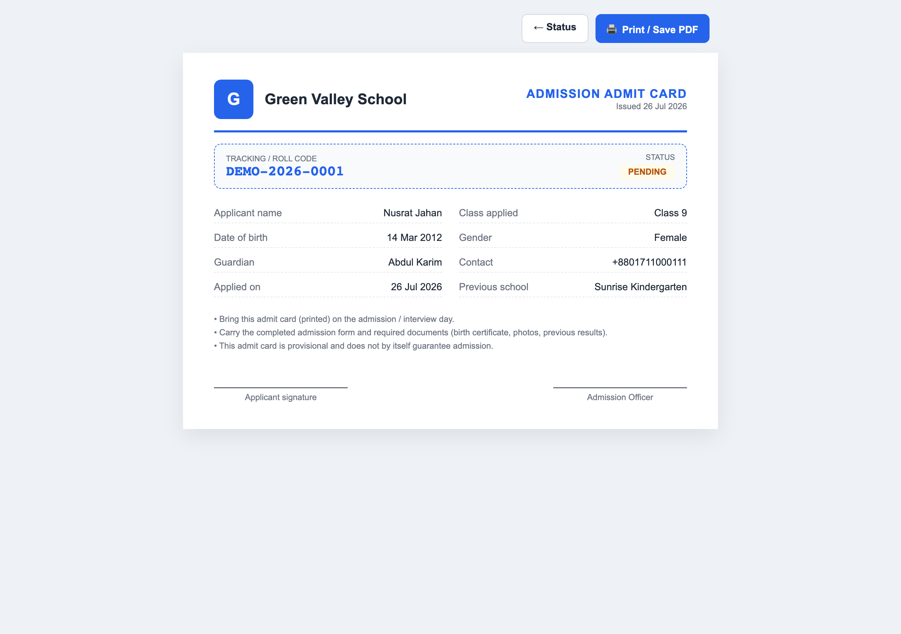

### আবেদন ইনবক্স (School Admin)

Status কাউন্টার (total / pending / approved / rejected), আবেদনকারী বা অভিভাবক দিয়ে search,
status filter, শেয়ারযোগ্য পাবলিক আবেদন লিংক, এবং ভর্তি চালু/বন্ধের এক-ক্লিক টগল।

**URL:** `/app/admissions/`

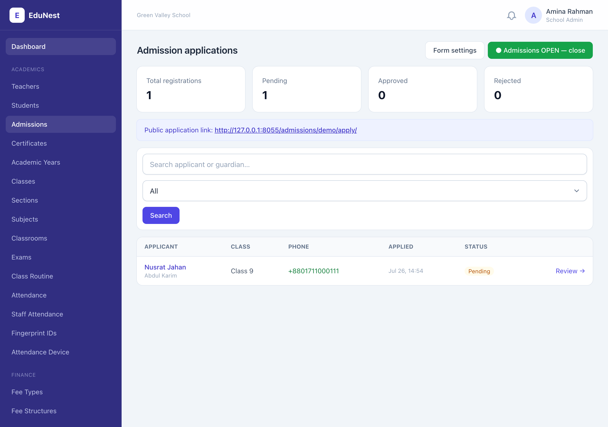

### আবেদন রিভিউ

Approve করলে placement চাওয়া হয় — admission number (auto-suggest `YYYY-NNNN`), class,
section, academic year, roll — তারপর `Student` রেকর্ড তৈরি করে, আবেদনকারীর তথ্য কপি করে,
এবং guardian ফিল্ড থেকে একটি `Guardian` তৈরি করে। Reject করলে একটি কারণ রেকর্ড হয়। যেকোনো
ক্ষেত্রেই reviewer ও timestamp সংরক্ষিত হয়।

**URL:** `/app/admissions/<id>/`

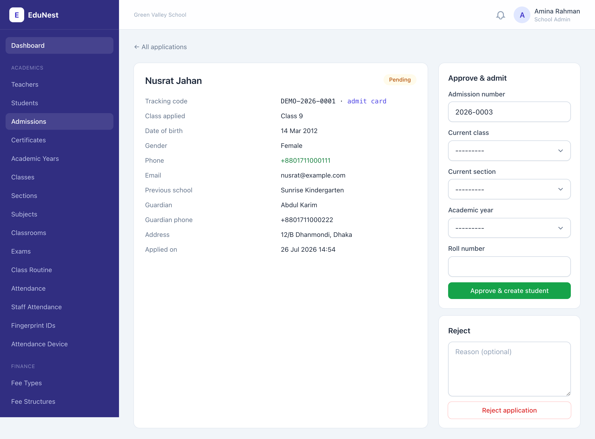

### ভর্তি ফর্ম সেটিংস

অনলাইন বনাম ডাউনলোডযোগ্য-PDF মোড বাছাই, প্রিন্টযোগ্য ফর্ম আপলোড, এবং আবেদনকারীরা যে
নির্দেশনা দেখবে তা লেখা।

**URL:** `/app/admissions/settings/`

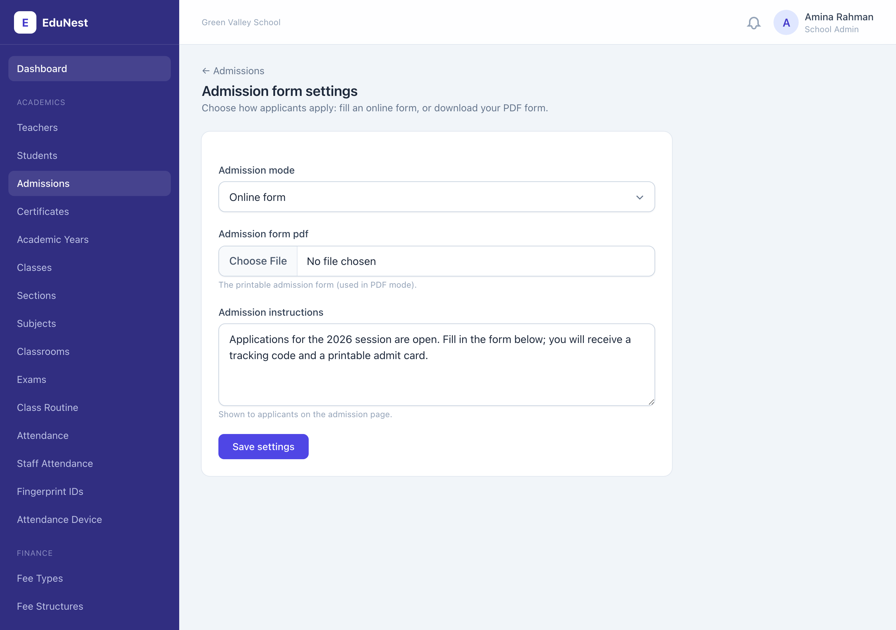

---

## ৬. Super Admin কনসোল

প্ল্যাটফর্ম মালিকের ওয়ার্কস্পেস। Super Admin-এর কোনো নিজস্ব স্কুল নেই; তারা প্ল্যাটফর্ম view-তে
কাজ করেন, এবং প্রয়োজনে কোনো tenant-এর ভেতরে "ঢোকেন"।

### প্ল্যাটফর্ম ড্যাশবোর্ড

প্রতিটি tenant জুড়ে KPI: মোট স্কুল, active / trial / suspended সংখ্যা, মোট শিক্ষার্থী এবং
প্রত্যাশিত আয় (শিক্ষার্থী × ৳১০)। নিচে ক্লিকযোগ্য ফোন নম্বরসহ contact-lead ইনবক্স এবং
সাম্প্রতিক তৈরি স্কুলগুলো।

**URL:** `/app/`

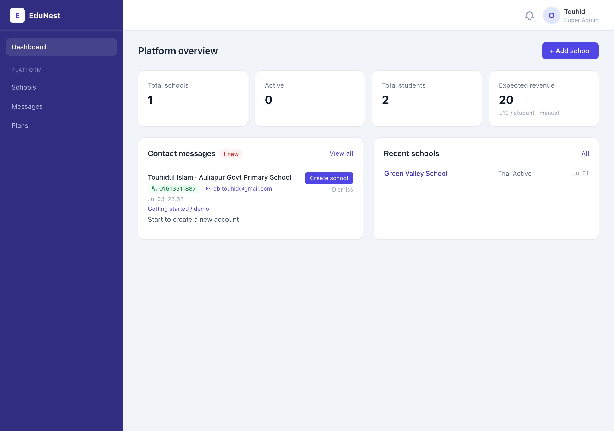

### স্কুলসমূহ

নাম / slug / admin email জুড়ে search এবং একটি status filter সহ প্রতিটি tenant।

**URL:** `/app/schools/`

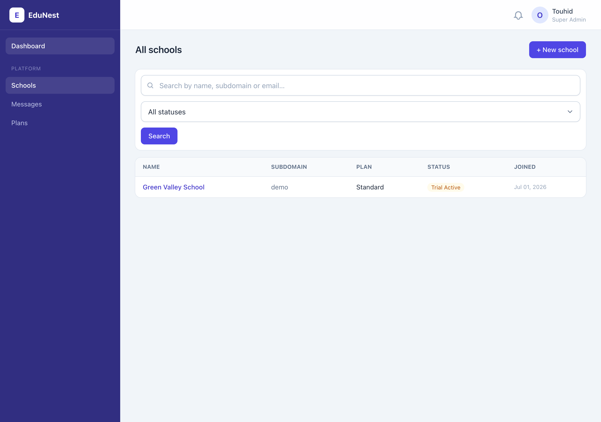

### স্কুল ডিটেইল ও লাইফসাইকেল

একটি tenant-এর প্রোফাইল ও লাইভ স্ট্যাটস (শিক্ষার্থী ও শিক্ষক সংখ্যা), এবং status কন্ট্রোল যা
স্কুলকে তার লাইফসাইকেলে সরায়:

`Pending Verification → Trial Active → Active → Trial Expired / Payment Failed / Suspended / Cancelled`

`School.has_access` কেবল **Trial Active** ও **Active**-এর জন্য true।

এখান থেকে **Manage this school** tenant-কে session-এ সংরক্ষণ করে Super Admin-কে সেই স্কুলের
admin ওয়ার্কস্পেসে নামিয়ে দেয়; **Exit school** প্ল্যাটফর্ম view-তে ফিরিয়ে আনে।

**URL:** `/app/schools/<id>/`

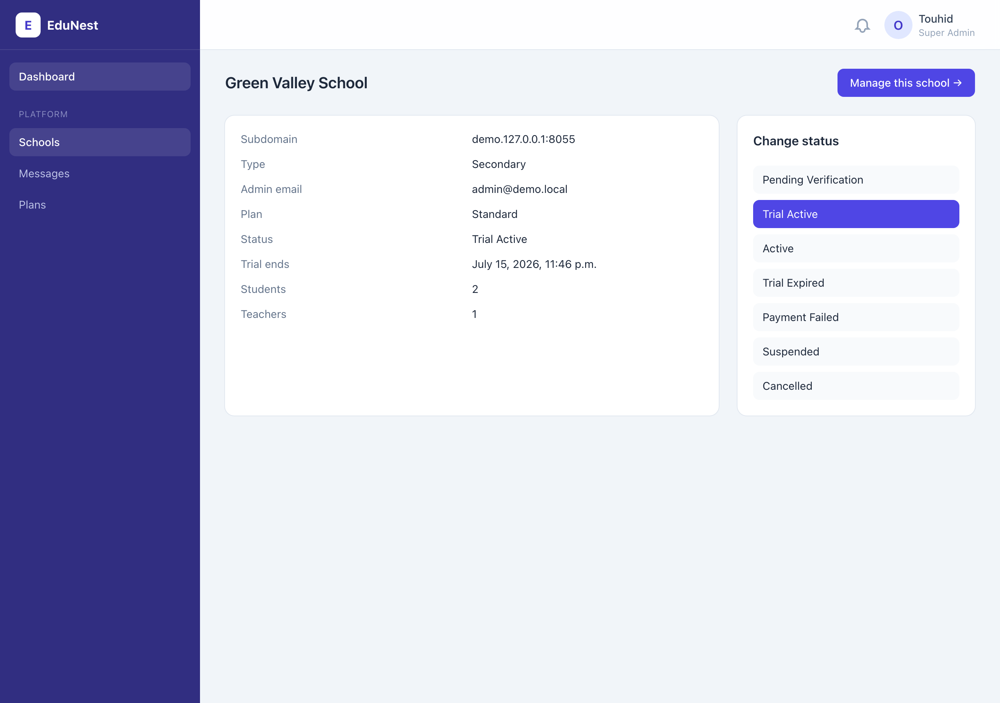

### স্কুল তৈরি

এক ফর্মে ম্যানুয়াল প্রোভিশনিং: স্কুলের নাম, ধরন, সাবডোমেইন slug (uniqueness-যাচাইকৃত), admin
নাম/email/পাসওয়ার্ড (লগইনও তৈরি হয়), দেশ, status, এবং স্কুলের বায়োমেট্রিক ডিভাইস ব্র্যান্ড ও
API credential। সেভ করলে একটি ধাপেই tenant **এবং** এর School Admin অ্যাকাউন্ট তৈরি হয়।

**URL:** `/app/schools/create/`

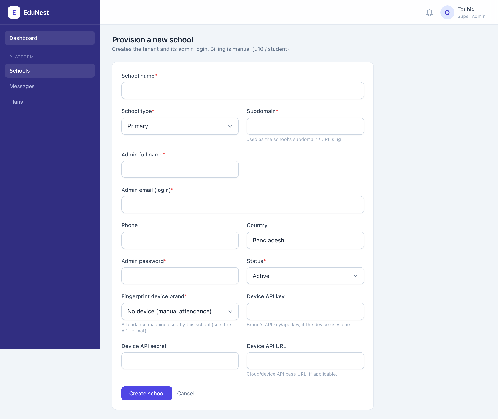

### Contact messages (লিড)

অনুসন্ধানের উপর সম্পূর্ণ CRUD: search, open/handled filter, ফোন ও email লিংক, edit, delete,
handled মার্ক, এবং **convert to school** — যা লিড থেকে create-school ফর্ম pre-fill করে এবং
স্কুল তৈরি হলে দুটি রেকর্ড যুক্ত করে দেয়।

**URL:** `/app/leads/` · `/app/leads/<id>/`

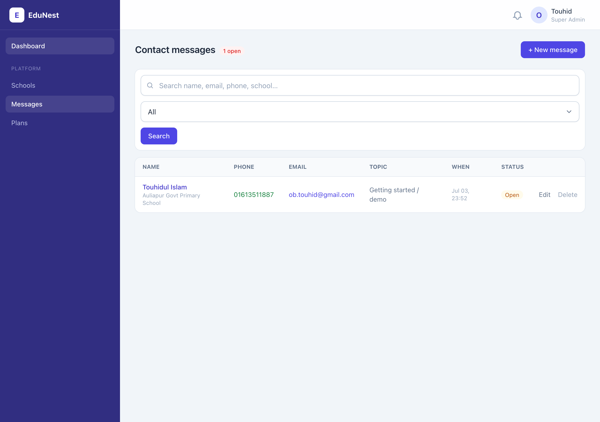

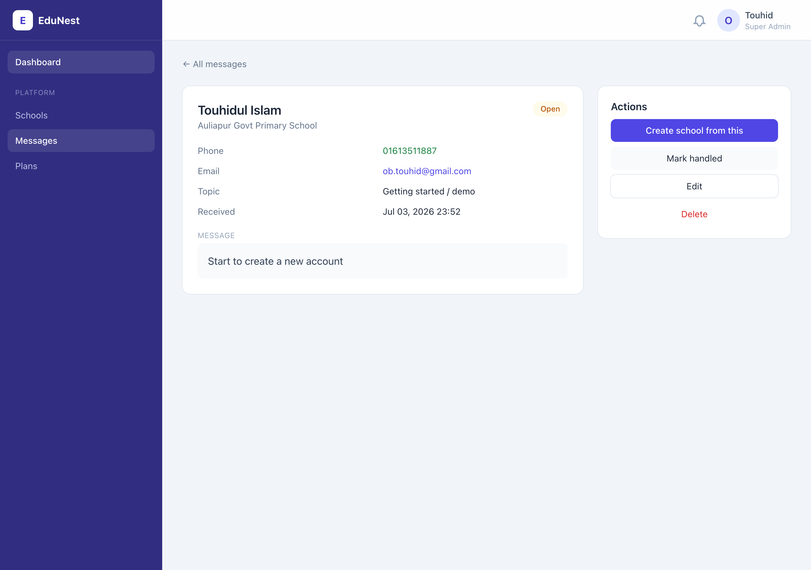

### সাবস্ক্রিপশন প্ল্যান

প্ল্যান সংজ্ঞা: tier (Trial / Basic / Standard / Premium / Enterprise), শিক্ষার্থী সীমা
(null = আনলিমিটেড), মাসিক ও বাৎসরিক মূল্য, একটি JSON feature map, এবং একটি active ফ্ল্যাগ।
যেহেতু বিলিং বর্তমানে অফলাইন, প্ল্যানগুলো enforced paywall নয়, বরং metadata।

**URL:** `/app/plans/`

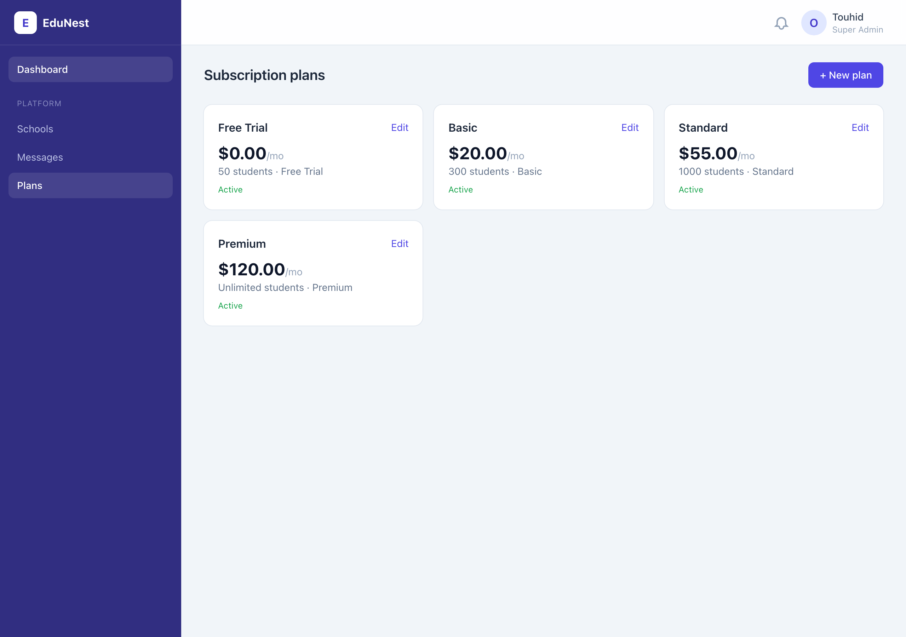

---

## ৭. School Admin — সেটআপ ও অ্যাকাডেমিকস

### ড্যাশবোর্ড

শিক্ষার্থী, শিক্ষক ও ক্লাসরুম সংখ্যা, মোট আদায়কৃত ফি, বকেয়া ইনভয়েস, সাম্প্রতিক ভর্তি এবং কুইক
অ্যাকশন।

**URL:** `/app/`

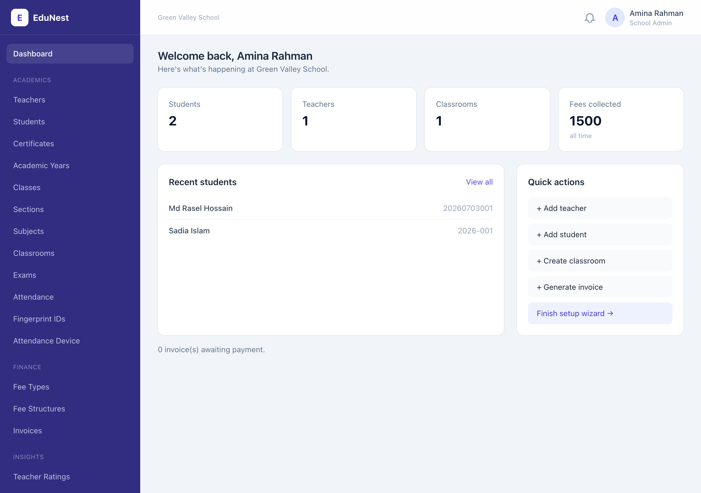

### সেটআপ উইজার্ড

ডেটাবেস থেকে লাইভ গণনা করা পাঁচ-ধাপের প্রস্তুতি চেকলিস্ট — স্কুল প্রোফাইল, অ্যাকাডেমিক
স্ট্রাকচার, ফি টাইপ, অন্তত একজন শিক্ষক, অন্তত একজন শিক্ষার্থী — একটি completion কাউন্টারসহ।
এটি blocking উইজার্ড নয়; এটি একটি progress view যেখানে admin ফিরে আসতে পারেন।

**URL:** `/app/onboarding/`

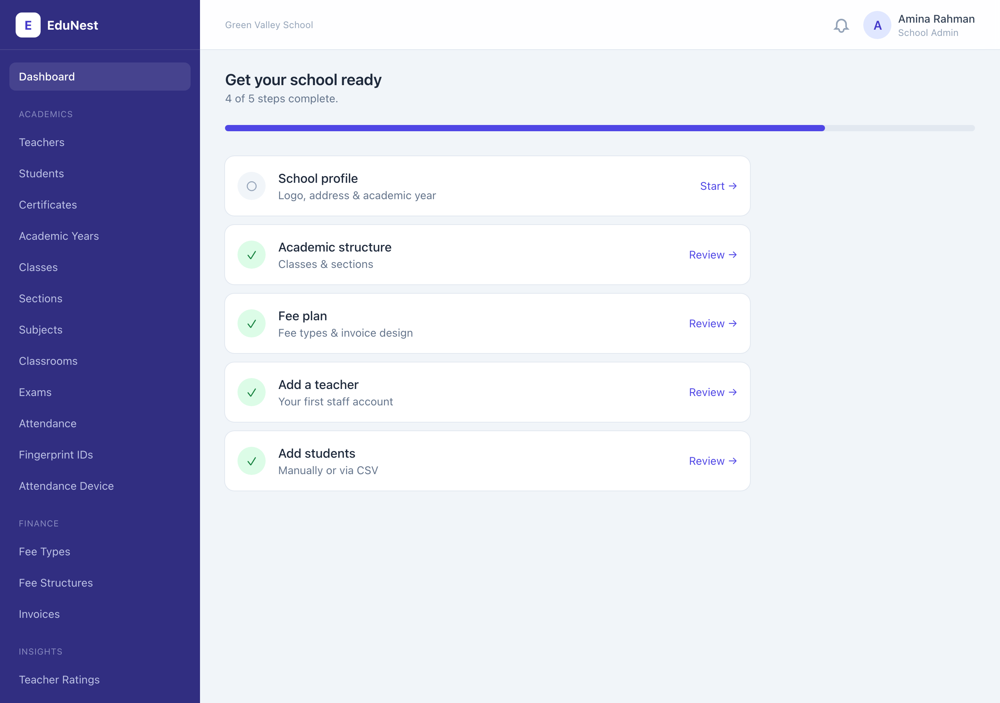

### অ্যাকাডেমিক ইয়ার

`2026` বা `2026-2027`-এর মতো সেশন, start/end তারিখসহ এবং একটি current হিসেবে চিহ্নিত। স্কুল
প্রতি unique।

**URL:** `/app/years/`

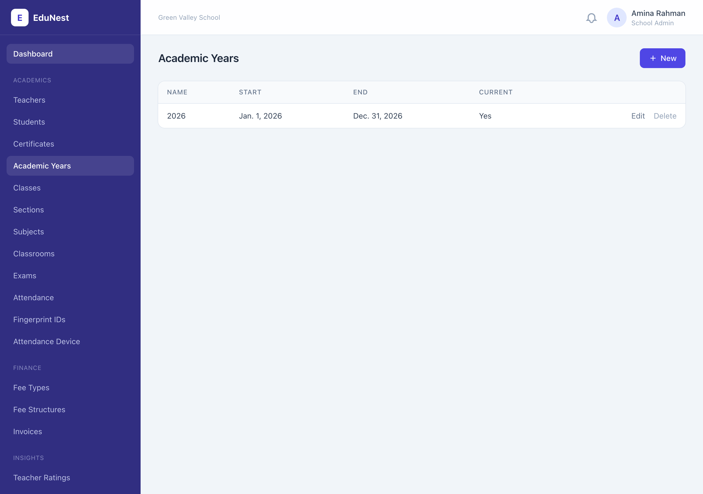

### ক্লাস

গ্রেড লেভেল, promotion ordering ও সামঞ্জস্যপূর্ণ sorting-এর জন্য একটি `numeric_level` সহ।

**URL:** `/app/classes/`

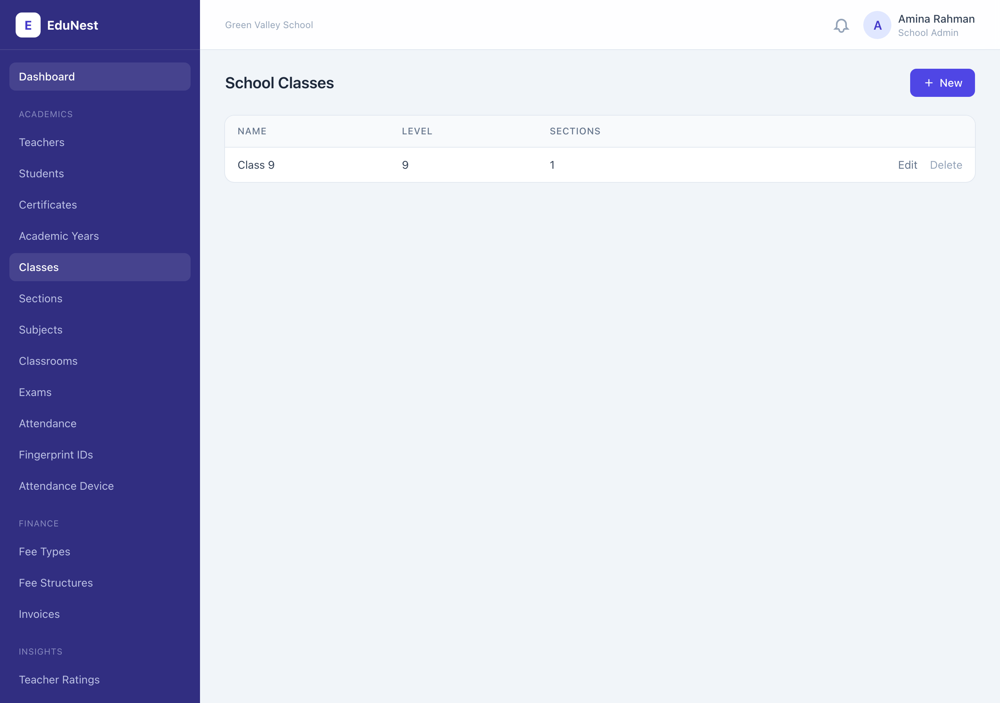

### সেকশন

সেকশন একটি ক্লাস **এবং** একটি অ্যাকাডেমিক ইয়ারের অধীনে থাকে, এবং একজন class teacher থাকতে
পারে। (class, year, name) প্রতি unique।

**URL:** `/app/sections/`

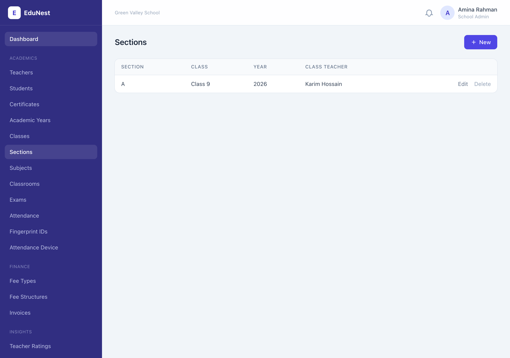

### বিষয়

ঐচ্ছিক কোডসহ searchable বিষয় ক্যাটালগ।

**URL:** `/app/subjects/`

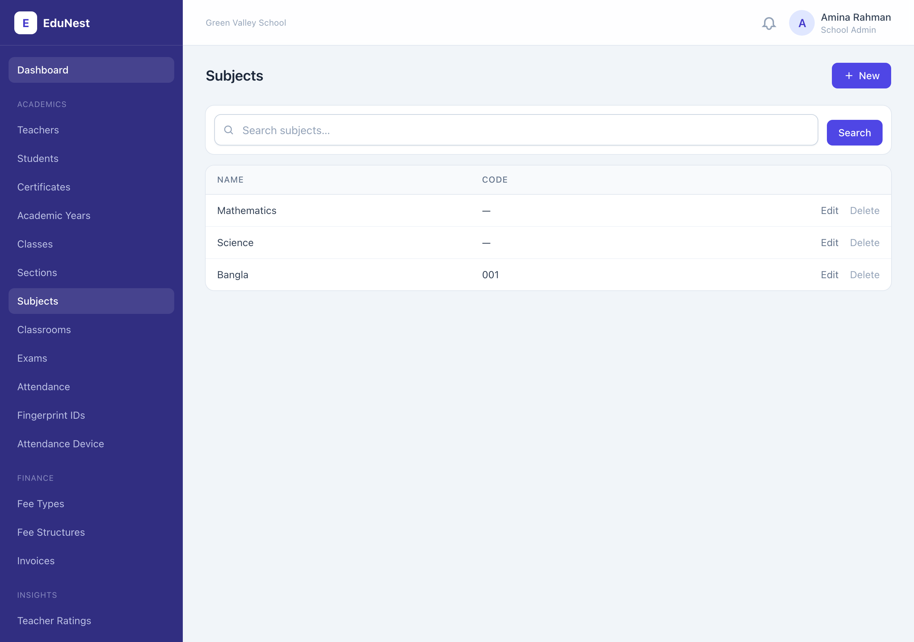

### ক্লাস রুটিন (টাইমটেবল)

একবারে এক সেকশনের সাপ্তাহিক গ্রিড builder। প্রতিটি slot বহন করে দিন, period নম্বর, start ও
end time, বিষয়, শিক্ষক, রুম, অথবা non-teaching row-এর জন্য একটি **break/lunch** ফ্ল্যাগ।

সীমাবদ্ধতা ও আচরণ:

- (section, weekday, period) প্রতি একটি slot — ডেটাবেস লেভেলে প্রয়োগকৃত।
- End time অবশ্যই start time-এর পরে হতে হবে; non-break slot-এ অবশ্যই একটি বিষয় থাকতে হবে
  (form-লেভেল)।
- (school, section, day) ও (school, teacher, day) দিয়ে indexed, তাই শিক্ষার্থী ও শিক্ষক
  উভয় view দ্রুত থাকে।
- একই গ্রিড স্বয়ংক্রিয়ভাবে শিক্ষক ও শিক্ষার্থীর ব্যক্তিগত রুটিনে খাবার সরবরাহ করে।

**URL:** `/app/routine/?section=<id>`

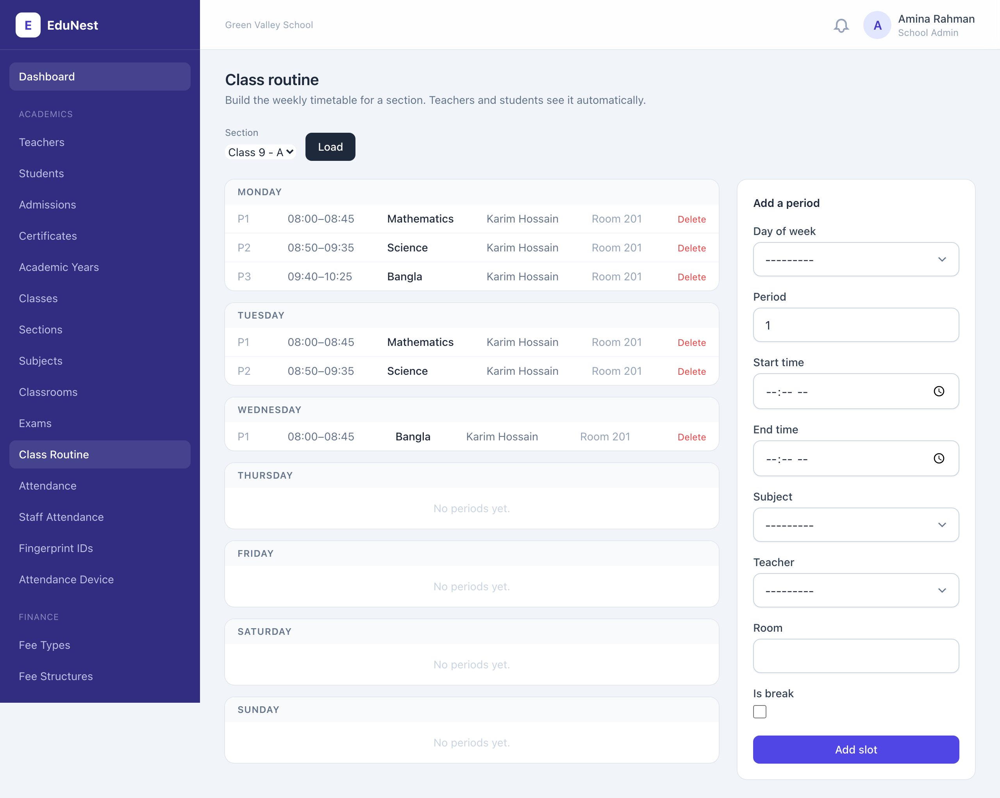

---

## ৮. School Admin — স্টাফ ব্যবস্থাপনা

### পদবি (Designations)

স্বাধীনভাবে কনফিগারযোগ্য প্রতি-স্কুল পদবি ল্যাডার (Principal, Head Teacher, Senior
Teacher…), `rank_order` দিয়ে সাজানো যেখানে ছোট মান বেশি জ্যেষ্ঠ।

**URL:** `/app/designations/`

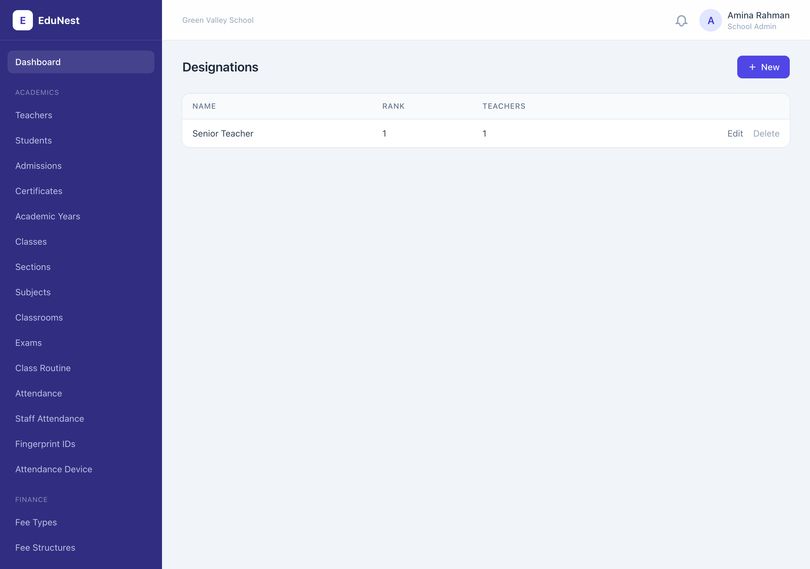

### শিক্ষক ডিরেক্টরি

নাম, email বা employee ID দিয়ে search; পদবি ও status (Active / Resigned / Terminated) দিয়ে
filter।

**URL:** `/app/teachers/`

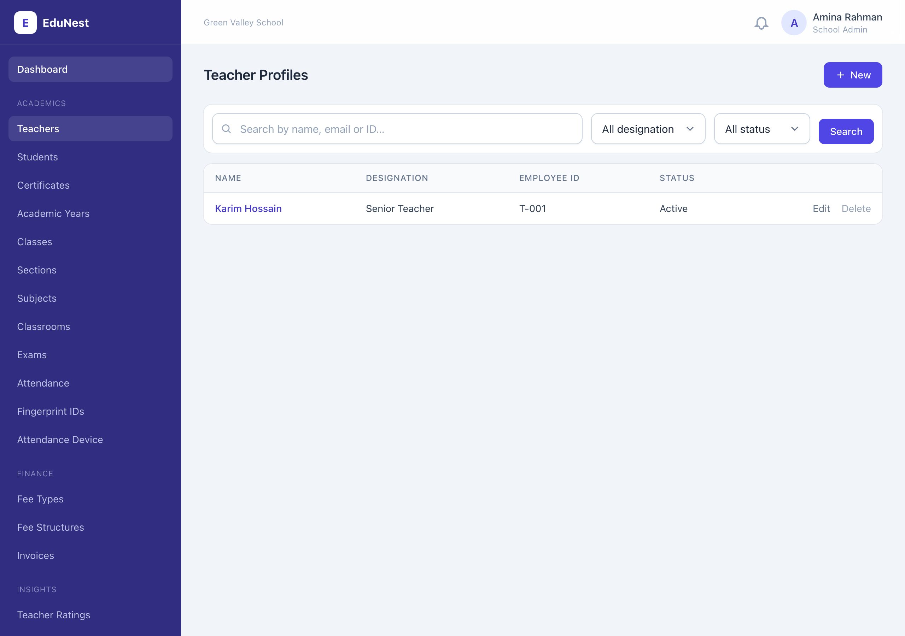

### শিক্ষক যোগ / সম্পাদনা

একটি ফর্মেই লগইন অ্যাকাউন্ট ও প্রোফাইল উভয় তৈরি হয়: নাম, email, পাসওয়ার্ড (খালি রাখলে
auto-generate), employee ID, পদবি, joining তারিখ, contract type (Permanent / Part-time /
Contract), assign করা বিষয় ও সেকশন, মূল বেতন ও status। email থেকে username স্বয়ংক্রিয়ভাবে
de-duplicate হয়।

**URL:** `/app/teachers/create/`

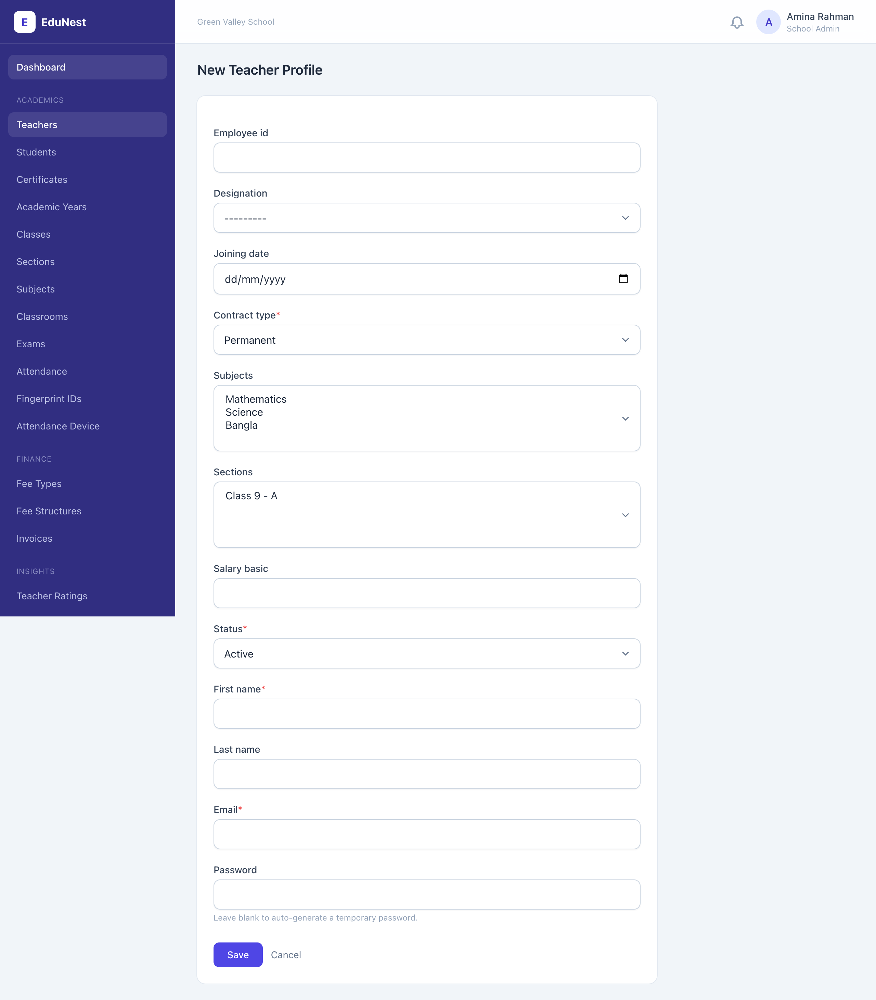

### শিক্ষক ডিটেইল

প্রোফাইল, রেটিং সারাংশ এবং শিক্ষক যে ক্লাসরুমগুলোতে assigned সেগুলো।

**URL:** `/app/teachers/<id>/`

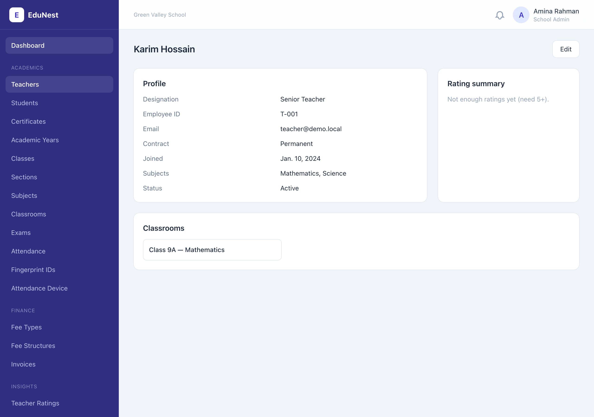

---

## ৯. School Admin — শিক্ষার্থী ব্যবস্থাপনা

### শিক্ষার্থী ডিরেক্টরি

নাম, admission number বা roll দিয়ে search; class, section ও status (Active / Transferred /
Alumni / Inactive) দিয়ে filter।

**URL:** `/app/students/`

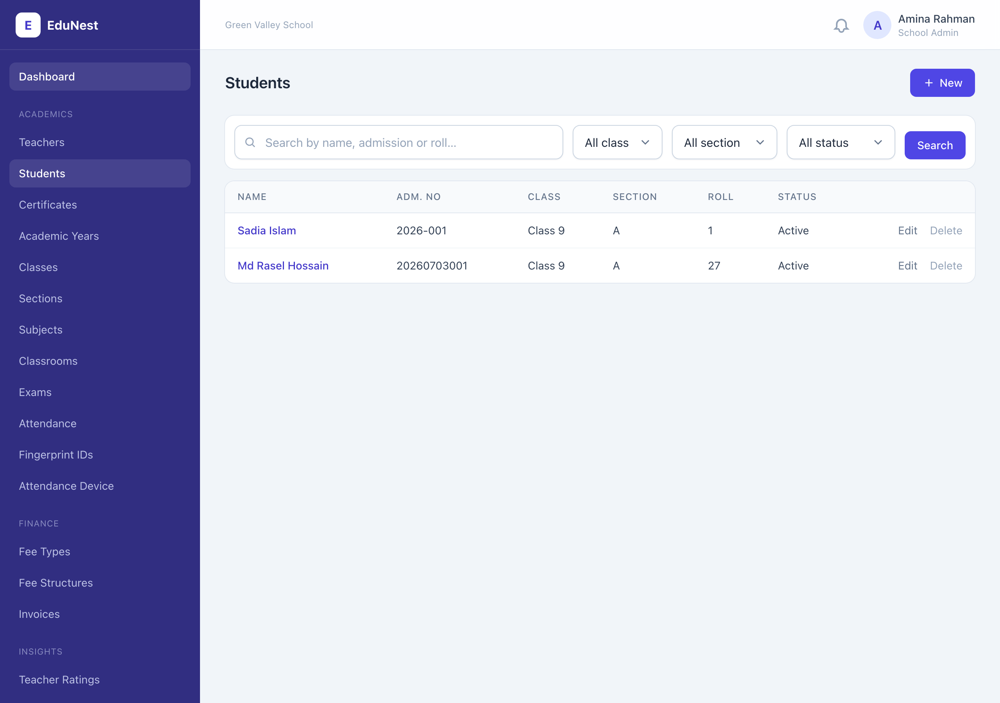

### শিক্ষার্থী যোগ / সম্পাদনা

সম্পূর্ণ ভর্তি রেকর্ড: নাম, admission number (স্কুল প্রতি unique), roll, জন্মতারিখ, লিঙ্গ,
রক্তের গ্রুপ, ছবি আপলোড, class / section / academic year placement, ভর্তির তারিখ ও ধরন,
ঠিকানা, জরুরি যোগাযোগ, পূর্ববর্তী স্কুল, মেডিকেল নোট (admin-only) এবং status।

**URL:** `/app/students/create/`

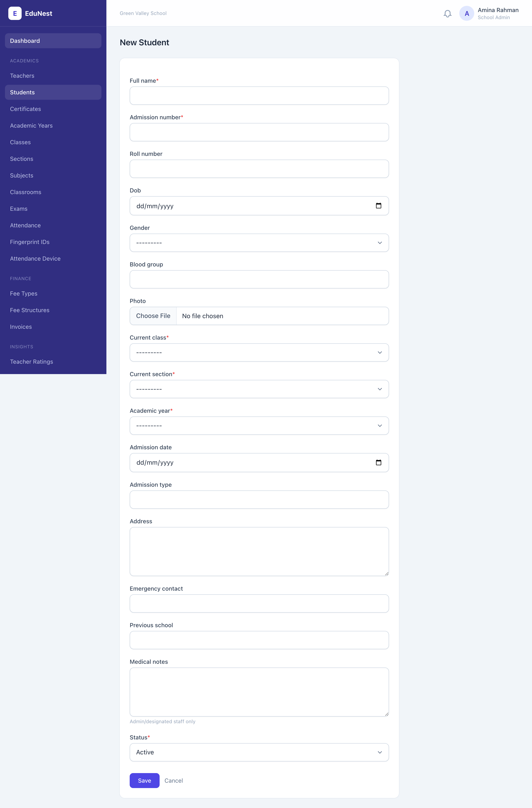

### শিক্ষার্থী ডিটেইল

এক view-তে প্রোফাইলসহ অভিভাবক, ইনভয়েস ও পরীক্ষার ফলাফল, এবং ID card, admission slip, পোর্টাল
লগইন ও সার্টিফিকেট ইস্যুর অ্যাকশন। অভিভাবক এখান থেকে যোগ করা হয় — সম্পর্ক, নাম, ফোন, email,
পেশা, NID, primary-contact ফ্ল্যাগ এবং তারা parent পোর্টালে লগইন করতে পারবে কিনা।

**URL:** `/app/students/<id>/`

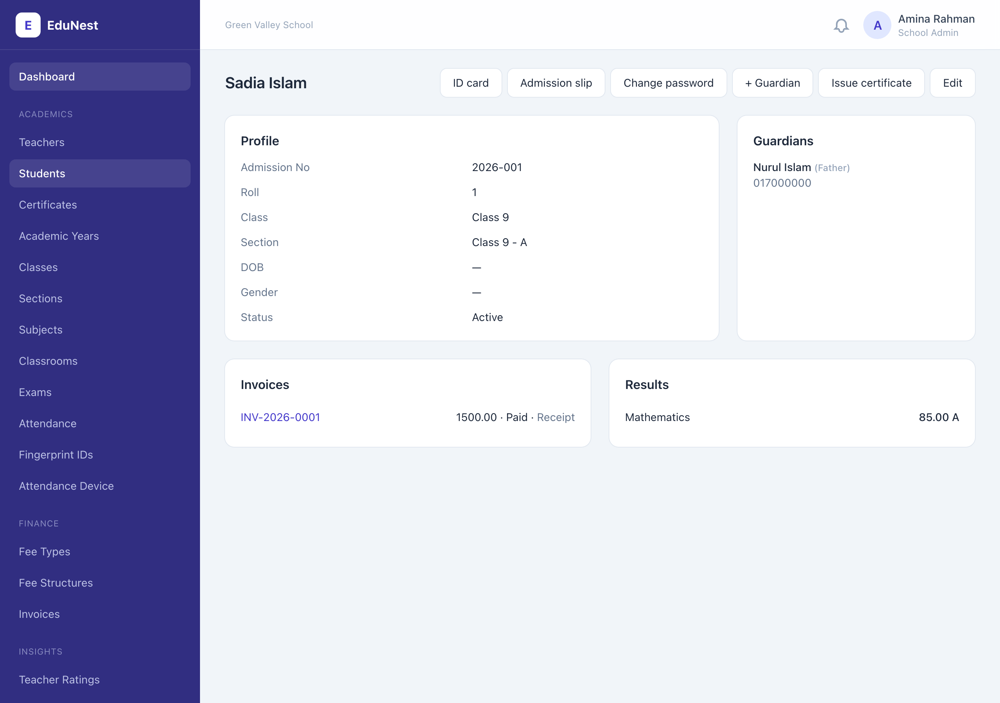

### পোর্টাল লগইন credential

শিক্ষার্থীর পোর্টাল অ্যাকাউন্ট ইস্যু বা রিসেট। একবার তৈরি হলে **login ID স্থায়ী** — পরবর্তী
edit-এ ফিল্ডটি disabled থাকে — এবং শুধু পাসওয়ার্ড পরিবর্তন করা যায়। অস্থায়ী পাসওয়ার্ডটি
শিক্ষার্থী রেকর্ডে সংরক্ষিত হয় যাতে অফিস তা admission slip-এ প্রিন্ট করতে পারে।

**URL:** `/app/students/<id>/credentials/`

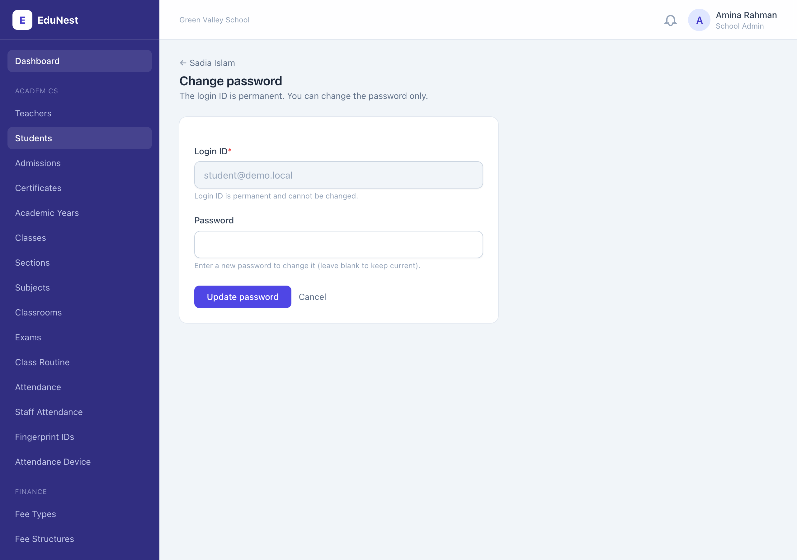

---

## ১০. ক্লাসরুম (Google-Classroom স্টাইল)

একটি `ClassRoom` হলো **বিষয় × সেকশন × অ্যাকাডেমিক ইয়ার**-এর উপর keyed একটি সহযোগিতামূলক
স্পেস, একটি join code, cover image, description এবং এক বা একাধিক assigned শিক্ষকসহ।

### ক্লাসরুম তালিকা ও কার্ড

search (নাম, code, বিষয়) ও বিষয় filter সহ table view; সাইন-ইন করা ইউজারের রুমের জন্য card
view।

**URL:** `/app/rooms/` · `/app/my-rooms/`

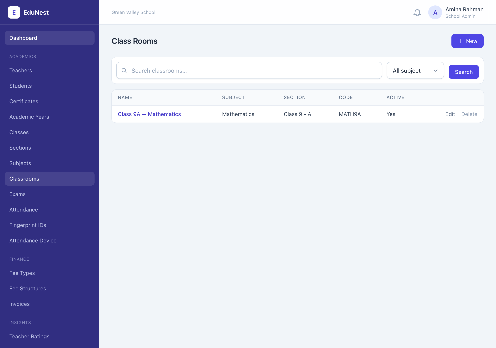

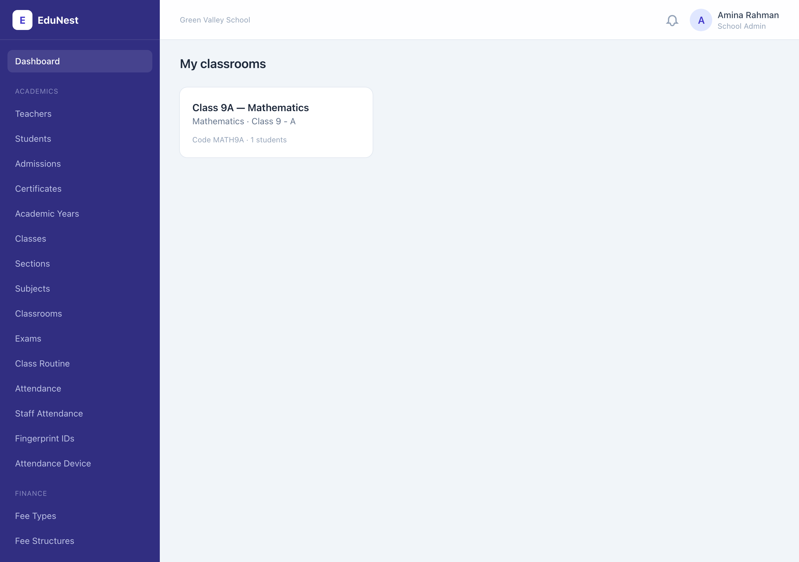

### ক্লাসরুম ডিটেইল

Tabbed ওয়ার্কস্পেস যেখানে থাকে:

- **Feed** — Announcement, Note বা Result হিসেবে typed পোস্ট, file attachment ও pinning সহ।
  শুধু admin ও রুমের নিজস্ব শিক্ষকরা পোস্ট করতে পারেন।
- **Notes** — study material: title, description, file আপলোড, video/YouTube লিংক, topic,
  chapter এবং একটি "important" ফ্ল্যাগ যা এটিকে উপরে pin করে।
- **Assignments** — title, নির্দেশনা, attachment, due date/time, মোট মার্কস, publish টগল।
- **Participants** — `RoomMembership` দিয়ে enrolled শিক্ষার্থী।

**URL:** `/app/rooms/<id>/`

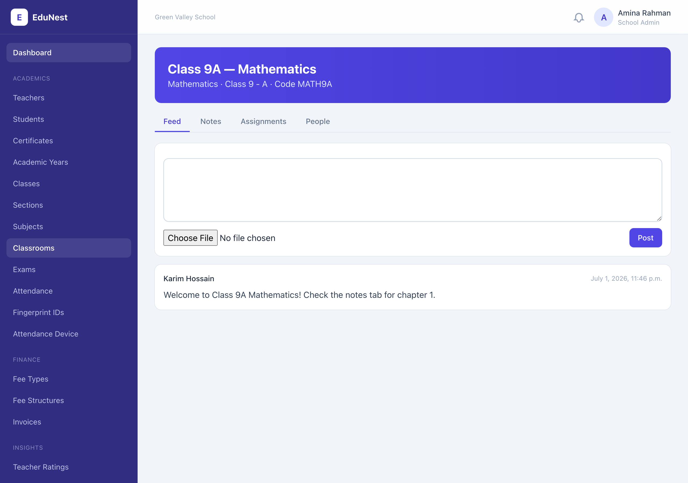

### অ্যাসাইনমেন্ট ও গ্রেডিং

শিক্ষার্থী একটি text answer (ও file) জমা দেয়; due date পেরোনো সাবমিশন স্বয়ংক্রিয়ভাবে
`is_late` মার্ক হয়। শিক্ষক প্রতিটি সাবমিশন দেখেন এবং মার্কস ও লিখিত feedback দেন; grader ও
grading timestamp রেকর্ড হয়। প্রতি অ্যাসাইনমেন্টে প্রতি শিক্ষার্থীর একটি সাবমিশন প্রয়োগকৃত।

**URL:** `/app/assignments/<id>/`

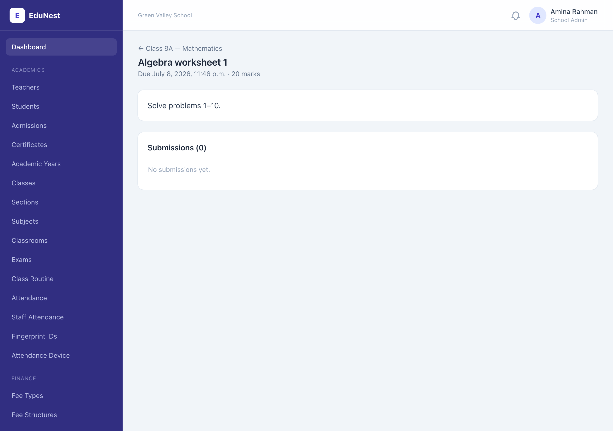

---

## ১১. পরীক্ষা ও ফলাফল

### পরীক্ষার সেশন

"Half-Yearly Exam 2026"-এর মতো নামযুক্ত সেশন, একটি অ্যাকাডেমিক ইয়ারের সাথে যুক্ত, start/end
তারিখ ও একটি publish ফ্ল্যাগসহ।

**URL:** `/app/exams/`

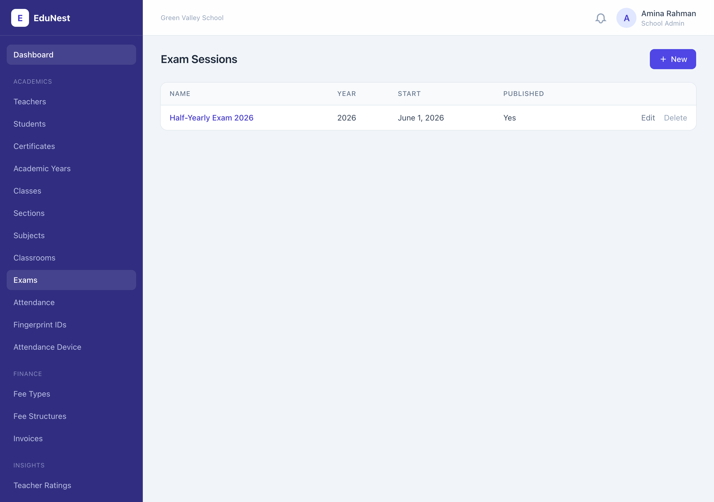

### পরীক্ষার বিষয়

প্রতি সেশনে, প্রতিটি (বিষয় × ক্লাস) জোড়া একটি পরীক্ষার তারিখ, মোট মার্কস ও পাস মার্কস পায়।
(session, subject, class) প্রতি unique।

**URL:** `/app/exams/<id>/`

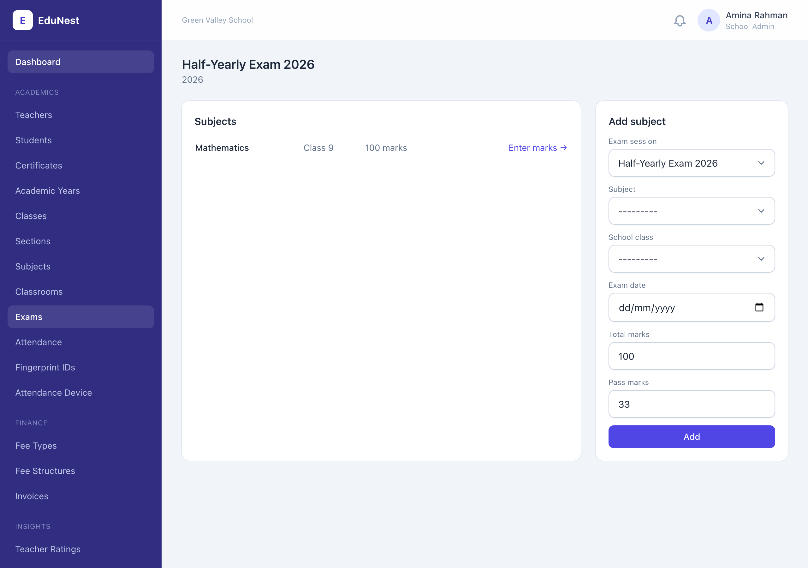

### মার্কস এন্ট্রি

একটি পরীক্ষার বিষয়ের জন্য ক্লাসের প্রতিটি শিক্ষার্থীর single-page গ্রিড। খালি cell বাদ পড়ে,
তাই আংশিক এন্ট্রি নিরাপদ এবং পুনরায় এন্ট্রি duplicate না করে update করে। প্রতিটি ফলাফল মার্কস,
ঐচ্ছিক grade ও grade point, একটি absent ফ্ল্যাগ, এবং কে এন্ট্রি করেছে তা সংরক্ষণ করে।

**URL:** `/app/exam-subjects/<id>/marks/`

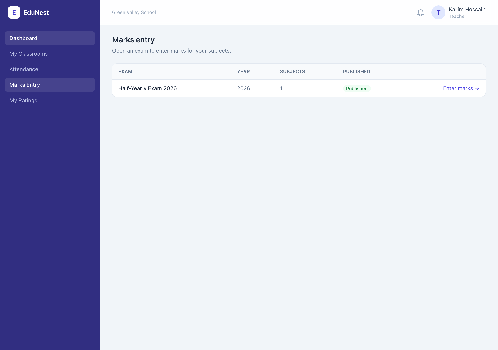

---

## ১২. উপস্থিতি (ম্যানুয়াল + বায়োমেট্রিক)

### দৈনিক শিক্ষার্থী উপস্থিতি

একটি সেকশন ও তারিখ বাছাই করুন, তারপর প্রতিটি শিক্ষার্থীকে Present / Absent / Late / On Leave
মার্ক করুন। বিদ্যমান মার্ক pre-fill হয়, এবং সেভ করলে জায়গামতো update হয় — প্রতি দিন প্রতি
শিক্ষার্থীর একটি রেকর্ড।

**URL:** `/app/attendance/`

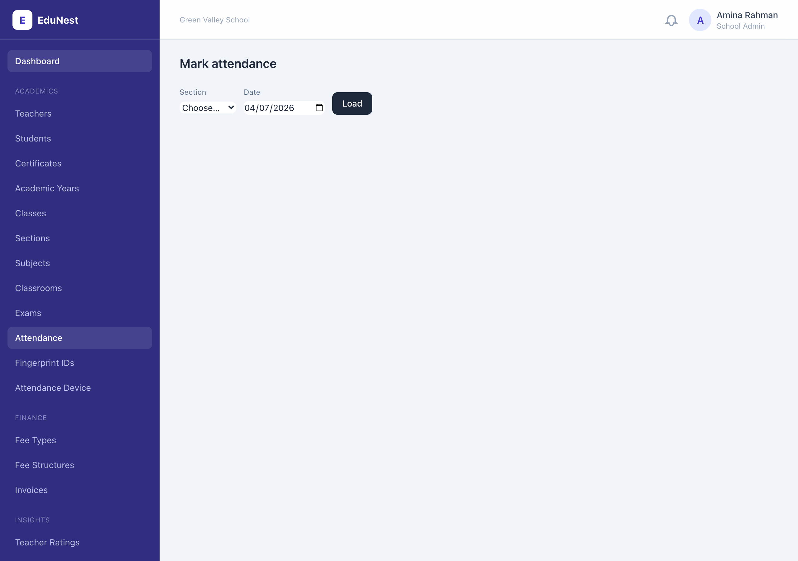

### স্টাফ উপস্থিতি

active শিক্ষকদের জন্য দৈনিক স্টাফ register, present ফ্ল্যাগ, check-in ও check-out time, এবং
একটি present-count সারাংশসহ।

**URL:** `/app/staff-attendance/`

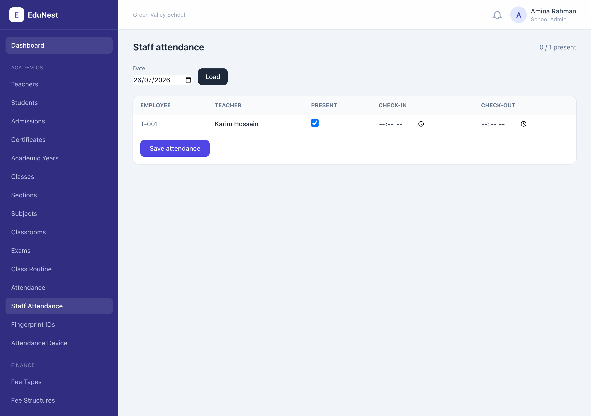

### বায়োমেট্রিক ডিভাইস কনফিগারেশন

স্কুলের fingerprint ডিভাইস ব্র্যান্ড বাছাই করুন, এর API key / secret / URL দিন, এবং **late
threshold** সেট করুন — এই লোকাল time-এ বা পরে পাঞ্চ করলে শিক্ষার্থী Present-এর বদলে Late মার্ক
হয়। পেজটি দেখায় ingest URL, প্রতি-স্কুল ডিভাইস token (এক ক্লিকে regenerable), unresolved
পাঞ্চের সংখ্যা, এবং troubleshooting-এর জন্য সাম্প্রতিক ২০টি raw পাঞ্চ।

সমর্থিত ব্র্যান্ড: **ZKTeco**, **ESSL**, **Suprema BioStar**, **Hikvision**, **Mantra**, এবং
অন্য যেকোনো কিছুর জন্য একটি **Generic JSON webhook**।

**URL:** `/app/devices/`

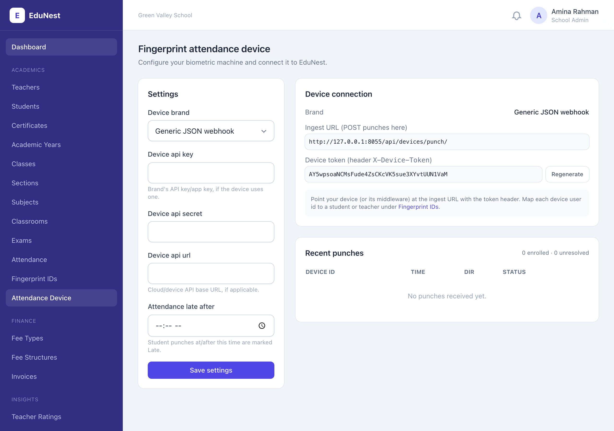

### Fingerprint ID এনরোলমেন্ট

একটি ডিভাইসের অভ্যন্তরীণ user ID-কে প্ল্যাটফর্ম ব্যক্তির সাথে ম্যাপ করে — ঠিক একজন শিক্ষার্থী
বা একজন শিক্ষক, form লেভেলে যাচাইকৃত। এই ম্যাপিং ছাড়া পাঞ্চ *unresolved* হিসেবে লগ হয়, এবং
এনরোলমেন্ট তৈরি হলে পরে প্রয়োগ করা যায়।

**URL:** `/app/biometric/`

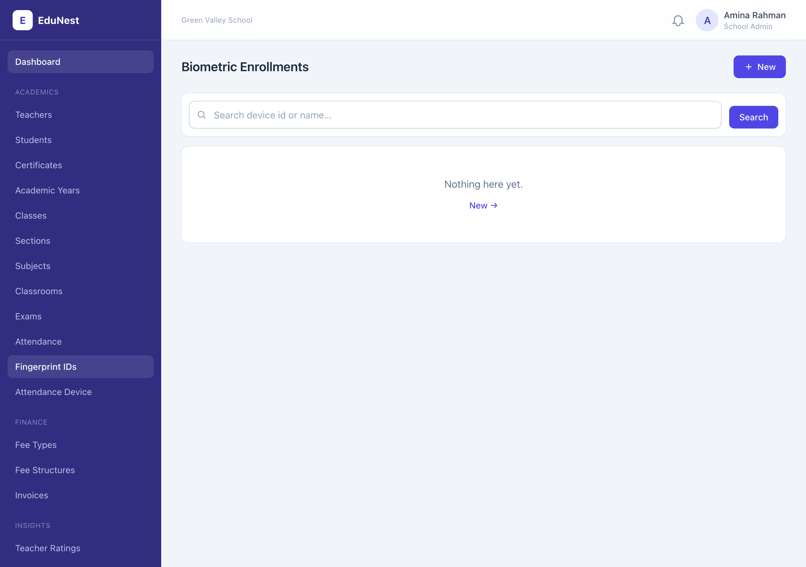

---

## ১৩. ফি, ইনভয়েস ও পেমেন্ট

### ফি টাইপ

দশটি বিল্ট-ইন ক্যাটাগরি — Admission, ID Card, Monthly Tuition, Exam, Annual, Re-admission,
Library, Transport, Hostel, Custom — প্রতিটির একটি frequency (One-time / Monthly / Per Term
/ Annually / Event-based), mandatory ফ্ল্যাগ, active ফ্ল্যাগ ও display order সহ।

**URL:** `/app/fee-types/`

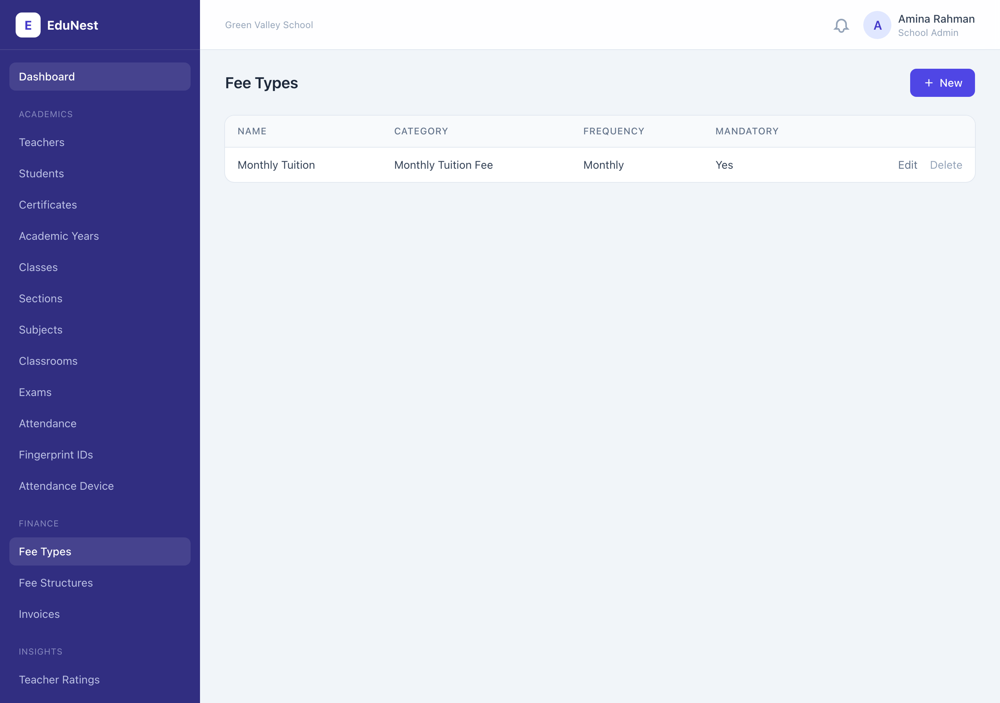

### ফি স্ট্রাকচার

একটি অ্যাকাডেমিক ইয়ারে একটি ফি টাইপের পরিমাণ, ঐচ্ছিকভাবে এক ক্লাসে scoped। ক্লাস খালি রাখলে
এটি **সব** ক্লাসে প্রযোজ্য হয়।

**URL:** `/app/fee-structures/`

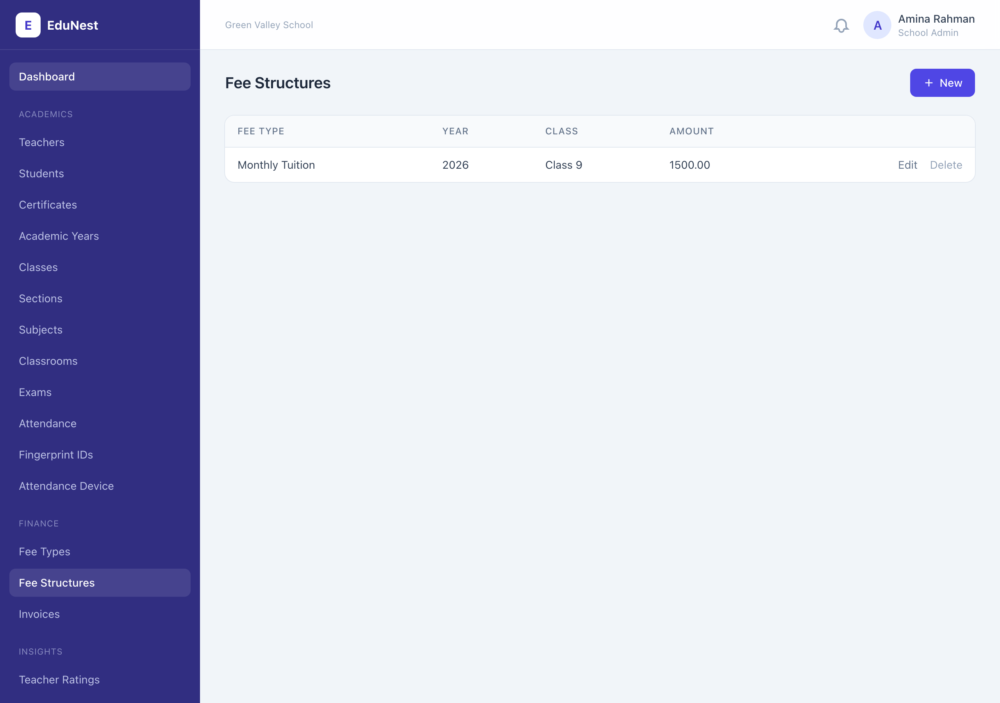

### ইনভয়েস

invoice number বা শিক্ষার্থীর নাম দিয়ে search, status (Draft / Sent / Paid / Partially Paid /
Overdue / Cancelled) দিয়ে filter।

**URL:** `/app/invoices/`

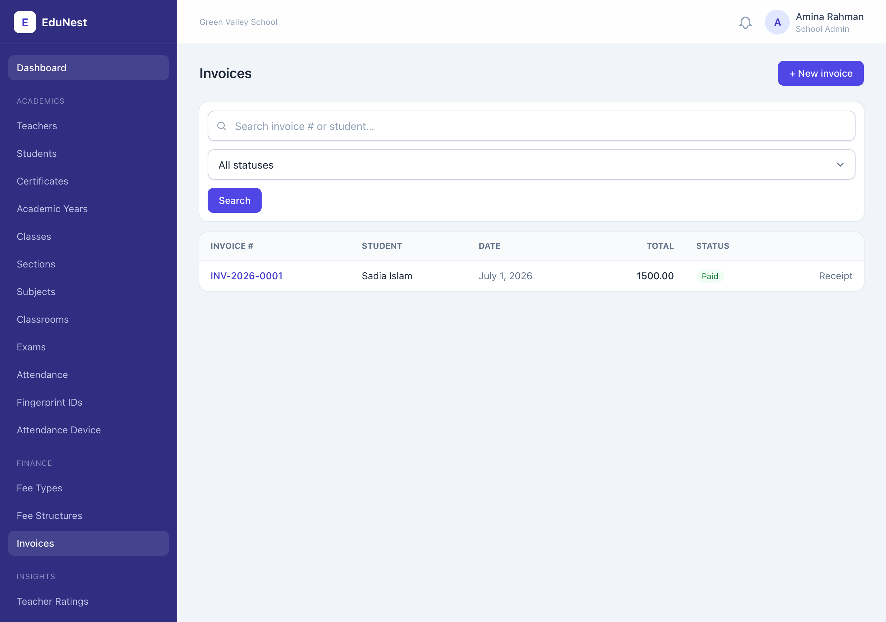

### ইনভয়েস তৈরি — ফি স্ট্রাকচার থেকে auto-fill

শিক্ষার্থী, ইয়ার ও মাস বাছাই করুন; ইনভয়েস সেই শিক্ষার্থীর ক্লাসের সাথে মিলে যাওয়া ফি
স্ট্রাকচার (এবং সব-ক্লাসেরগুলো) থেকে **নিজের line item তৈরি করে**, subtotal ও grand total যোগ
করে, এবং খালি রাখলে invoice number `INV-YYYY-NNNN` হিসেবে auto-generate করে।

### ইনভয়েস ডিটেইল ও পেমেন্ট রেকর্ডিং

Line item, subtotal, discount, late fine ও grand total, নিচে পেমেন্ট ইতিহাসসহ। একটি পেমেন্ট
রেকর্ড করলে (Cash / Online / Bank Transfer, transaction ID ও timestamp সহ) paid amount
পুনরায় total করে এবং ইনভয়েসকে স্বয়ংক্রিয়ভাবে **Paid** বা **Partially Paid**-এ পাল্টে দেয়।
প্রতিটি পেমেন্টে receiving user সংরক্ষিত হয়।

**URL:** `/app/invoices/<id>/`


---

## ১৪. শিক্ষক রেটিং সিস্টেম

শিক্ষার্থীরা শিক্ষকদের **বেনামে** ছয়টি dimension-এ ১–৫ স্কেলে রেটিং দেয়: teaching quality,
punctuality, helpfulness, assignment feedback, communication ও overall।

মডেল ও view-তে তৈরি সুরক্ষা:

- প্রতি (student, teacher, rating period)-এ একটি রেটিং — একটি unique constraint দিয়ে
  প্রয়োগকৃত, তাই রেটিং spam করা যায় না।
- রেটিং শুধু তখনই গৃহীত হয় যখন একটি rating period `is_active`।
- একজন শিক্ষার্থী শুধু সেসব ক্লাসরুমের শিক্ষককে রেট করতে পারে যেখানে সে প্রকৃতপক্ষে enrolled।
- Text comment **admin-visible only** — শিক্ষক কখনো জানে না কে কী বলেছে।
- একজন শিক্ষকের aggregate **৫টি রেটিং** না পাওয়া পর্যন্ত ব্যক্তিগত থাকে, এবং কেবল তখনই পাবলিক
  লিডারবোর্ডে আসতে পারে।

### রেটিং পিরিয়ড

নামযুক্ত window (যেমন "Term 1 – 2026") start/end তারিখ, একটি active ফ্ল্যাগ ও eligible
ক্লাসসহ।

**URL:** `/app/rating-periods/`


### স্কুল রেটিং ড্যাশবোর্ড

স্কুলের প্রতিটি শিক্ষক রেটিং সংখ্যাসহ গড় overall স্কোর দিয়ে র‍্যাঙ্কড।

**URL:** `/app/ratings/`


### শিক্ষার্থী রেটিং ফর্ম

ছয়-dimension ফর্ম, শুধু শিক্ষার্থীর নিজের শিক্ষকদের জন্য দেখানো হয়।

**URL:** `/app/rate-teachers/`


### শিক্ষকের নিজের রেটিং

শিক্ষকের aggregate, ৫-রেটিং threshold পূরণ না হওয়া পর্যন্ত locked।

**URL:** `/app/my-ratings/`


---

## ১৫. সার্টিফিকেট ও প্রিন্টযোগ্য ডকুমেন্ট

### সার্টিফিকেট টেমপ্লেট

তিনটি টাইপ ডিফল্ট লেখাসহ আসে যা admin ইস্যুর আগে সম্পাদনা করেন: **Custom Certificate**,
**Testimonial** ও **Transfer Certificate**।

Body-তে `{placeholders}` সমর্থিত যা প্রিন্ট টাইমে শিক্ষার্থী ও স্কুল রেকর্ড থেকে substitute হয়,
লিঙ্গ-সঠিক pronoun সহ:

`{student_name}` `{first_name}` `{admission_no}` `{roll}` `{class}` `{section}`
`{section_clause}` `{dob}` `{gender}` `{school}` `{school_address}` `{date}` `{ref_no}`
`{he_she}` `{him_her}` `{his_her}` `{he_she_cap}` `{his_her_cap}`

অজানা token error না করে অপরিবর্তিত থাকে।

**URL:** `/app/certificates/` · `/app/certificates/create/`


### প্রিন্টযোগ্য আউটপুট

চারটি রিপোর্টই standalone প্রিন্ট-অপটিমাইজড HTML পেজ — ব্রাউজারের "Save as PDF" চূড়ান্ত
ডকুমেন্ট তৈরি করে, তাই সার্ভারে কোনো PDF engine ইনস্টল বা রক্ষণাবেক্ষণ করতে হয় না।

| ডকুমেন্ট | URL | বিষয়বস্তু |
|---|---|---|
| **Money receipt** | `/app/invoices/<id>/receipt/` | স্কুল ব্র্যান্ডিং, line item, পেমেন্ট, paid/due |
| **Student ID card** | `/app/students/<id>/id-card/` | CR80 লেআউট, ছবি, class/roll, admission no., QR code |
| **Admission slip** | `/app/students/<id>/admission-slip/` | শিক্ষার্থীর তথ্য, পোর্টাল লগইন, সম্পূর্ণ ফি schedule ও balance |
| **Certificate** | `/app/certificates/<id>/print/` | substitute করা placeholder সহ অলঙ্কৃত সার্টিফিকেট |


অ্যাক্সেস role-gated: admin ও accountant যেকোনোটি প্রিন্ট করতে পারেন; receipt ইনভয়েসের নিজের
শিক্ষার্থী ও তার অভিভাবকও পৌঁছাতে পারেন।

---

## ১৬. নোটিফিকেশন ও সেটিংস

### নোটিফিকেশন

চারটি channel (SMS, Push, Email, In-App) ও চারটি state (Queued, Sent, Failed, Read) সহ
প্রতি-ইউজার নোটিফিকেশন লগ। লগ ও in-app inbox বাস্তবায়িত; outbound SMS ও push গেটওয়ে এখনো
যুক্ত করা হয়নি।

**URL:** `/app/notifications/`


### স্কুল সেটিংস

স্কুল প্রোফাইল সারাংশ: নাম, ধরন, সাবডোমেইন, যোগাযোগের তথ্য, লোগো, ব্র্যান্ড রঙ ও প্ল্যান।

**URL:** `/app/settings/`


---

## ১৭. শিক্ষক ওয়ার্কস্পেস

### ড্যাশবোর্ড

Assigned ক্লাসরুম, pending grading সংখ্যা ও বিষয়সমূহ।

**URL:** `/app/`


### আমার ক্লাসরুম

শুধু এই শিক্ষক যে রুমগুলোতে assigned সেগুলো।

**URL:** `/app/my-rooms/`


### আমার শিক্ষণ রুটিন

শিক্ষকের নিজের সাপ্তাহিক schedule, admin-এর রুটিন গ্রিড থেকে স্বয়ংক্রিয়ভাবে derived।

**URL:** `/app/my-routine/`


### মার্কস এন্ট্রি

শিক্ষক যেসব পরীক্ষার সেশন খুলে মার্কস এন্ট্রি করতে পারেন।

**URL:** `/app/marks-entry/`


---

## ১৮. শিক্ষার্থী পোর্টাল

### ড্যাশবোর্ড

আসন্ন অ্যাসাইনমেন্ট, অপরিশোধিত ইনভয়েস ও enrolled ক্লাসরুম।

**URL:** `/app/`


### আমার ক্লাস রুটিন

শিক্ষার্থীর সেকশন টাইমটেবল, বিষয়, শিক্ষক ও রুমসহ।

**URL:** `/app/my-routine/`


### অ্যাসাইনমেন্ট

শিক্ষার্থীর রুম জুড়ে প্রতিটি অ্যাসাইনমেন্ট, সাবমিশন status সহ।

**URL:** `/app/my-assignments/`


### ফলাফল

পরীক্ষার ফলাফল, বিষয় ও সেশনসহ।

**URL:** `/app/my-results/`


### ফি

শিক্ষার্থীর নিজের ইনভয়েস, receipt লিংকসহ।

**URL:** `/app/my-invoices/`


---

## ১৯. অভিভাবক পোর্টাল

একজন অভিভাবক `Guardian` রেকর্ডের মাধ্যমে এক বা একাধিক শিক্ষার্থীর সাথে যুক্ত, এবং প্রতিটি
parent পেজ প্রতি সন্তান অনুযায়ী ডেটা গ্রুপ করে।

### ড্যাশবোর্ড

সন্তানের কার্ড, উপস্থিতি, ফলাফল ও ফি-তে লিংক করা।

**URL:** `/app/`


### উপস্থিতি · ফলাফল · ফি

প্রতি সন্তানের শেষ ৩০ দিনের উপস্থিতি, পরীক্ষার ফলাফল, এবং receipt লিংকসহ ইনভয়েস।

**URL:** `/app/child/attendance/` · `/app/child/results/` · `/app/child/invoices/`


---

## ২০. বায়োমেট্রিক ডিভাইস API

একটিমাত্র পাবলিক endpoint যেকোনো সমর্থিত ডিভাইস ব্র্যান্ড থেকে fingerprint পাঞ্চ ingest করে।

```
POST /api/devices/punch/
Auth: X-Device-Token: <school.device_token>     (অথবা ?token=)
Body: সেই স্কুলের ডিভাইস ব্র্যান্ড যা পাঠায়
```

Token প্রতি-স্কুল, ডিভাইস ব্র্যান্ড বাছাই করার মুহূর্তে auto-issued (৪০ random অক্ষর), এবং
ডিভাইস সেটিংস পেজ থেকে regenerable। Endpoint টি CSRF-exempt কারণ ডিভাইসের কোনো session নেই —
তাই token-ই একমাত্র credential এবং endpoint অবশ্যই HTTPS-এ সার্ভ করতে হবে।

### পাইপলাইন

```
POST → token → School            (token নেই/ভুল হলে 401)
            → brand adapter      (unsupported brand / unparsable body হলে 400)
            → list[Punch]        normalized: device_user_id, timestamp, direction, raw
            → scope_to(school)
            → ingest_punches()
                 ├─ device_user_id দিয়ে BiometricEnrollment lookup
                 ├─ student → StudentAttendance (Present, বা threshold পেরোলে Late)
                 ├─ teacher → StaffAttendance (প্রথম in, শেষ out)
                 └─ কোনো match নেই → BiometricPunch(status=unresolved)
            → {"ok": true, "received": n, "applied": n, "unresolved": n, "errors": n}
```

প্রতিটি পাঞ্চ raw payload ও একটি status (Applied / Unresolved / Duplicate / Error) সহ
`BiometricPunch` হিসেবে সংরক্ষিত হয়, যা একটি সম্পূর্ণ audit trail ও পরে reprocess করার
সক্ষমতা দেয়।

### Adapter

| ব্র্যান্ড | payload format |
|---|---|
| `generic` | `{"punches": [{"user_id", "timestamp", "direction"}]}` |
| `zkteco` | ADMS/ATTLOG push — tab-separated text line, `status` 1/3/5 = check-out |
| `essl` | ZKTeco-এর মতো একই ADMS protocol |
| `suprema` | BioStar 2 webhook — `{"events": [{"user_id", "datetime", "event"}]}` |
| `hikvision` | ISAPI `AccessControllerEvent`, `employeeNoString` / `attendanceStatus` সহ |
| `mantra` | Middleware Generic JSON shape forward করে |

প্রতিটি adapter fallback হিসেবে Generic JSON shape-ও গ্রহণ করে, তাই physical ডিভাইস
সাইটে আসার আগেই একটি integration টেস্ট করা যায়। Timestamp কয়েকটি format জুড়ে best-effort
parse হয় এবং timezone-aware করা হয়।

একটি ব্র্যান্ড যোগ করা মানে
[apps/attendance/devices/adapters.py](../apps/attendance/devices/adapters.py)-তে একটি
`parse(request) -> list[Punch]` মেথড লেখা — resolution ও attendance-writing পাইপলাইন
শেয়ার করা।

---

## ২১. ডেটা মডেল রেফারেন্স

### প্ল্যাটফর্ম লেভেল (tenant-scoped নয়)

| মডেল | মূল ফিল্ড |
|---|---|
| `School` | name, slug, custom_domain, type, admin_email, logo, primary_color, plan, status, trial_ends_at, onboarding_completed, admissions_open, admission_mode/pdf/instructions, device_brand/token/api_key/api_secret/api_url, attendance_late_after |
| `SubscriptionPlan` | name, tier, student_limit, price_monthly, price_yearly, features (JSON), is_active |
| `ContactMessage` | name, school_name, email, phone, topic, message, is_handled, converted_school |
| `User` | Django `AbstractUser` + role, school, phone |

### Tenant-scoped (সব `SchoolScopedModel` inherit করে)

| App | মডেল |
|---|---|
| `academics` | `AcademicYear`, `Subject`, `SchoolClass`, `Section`, `RoutineSlot` |
| `teachers` | `Designation`, `TeacherProfile`, `DesignationHistory` |
| `students` | `Student`, `Guardian`, `AdmissionApplication`, `StudentTransfer`, `Certificate` |
| `rooms` | `ClassRoom`, `RoomMembership`, `RoomPost`, `RoomPostComment`, `RoomPostReaction`, `Note`, `Assignment`, `AssignmentSubmission` |
| `fees` | `FeeType`, `FeeStructure`, `StudentFeeDiscount`, `InvoiceDesign`, `Invoice`, `Payment` |
| `ratings` | `RatingPeriod`, `TeacherRating`, `TeacherRatingAggregate` |
| `attendance` | `StudentAttendance`, `StaffAttendance`, `LeaveApplication`, `BiometricEnrollment`, `BiometricPunch` |
| `exams` | `ExamSession`, `ExamSubject`, `ExamResult` |
| `notifications` | `Notification` |

সবগুলো `TimeStampedModel` থেকে `created_at` / `updated_at` inherit করে।

### উল্লেখযোগ্য integrity constraint

| Constraint | যা প্রতিরোধ করে |
|---|---|
| `Student` unique (school, admission_number) | এক স্কুলে duplicate admission number |
| `Invoice` unique (school, invoice_number) | duplicate invoice number |
| `StudentAttendance` unique (student, date) | এক দিনে শিক্ষার্থীকে double-mark |
| `StaffAttendance` unique (teacher, date) | স্টাফকে double-mark |
| `TeacherRating` unique (teacher, student, period) | রেটিং spam |
| `ExamResult` unique (exam_subject, student) | duplicate মার্কস |
| `AssignmentSubmission` unique (assignment, student) | duplicate সাবমিশন |
| `RoutineSlot` unique (section, day, period) | একই slot-এ দুই ক্লাস |
| `BiometricEnrollment` unique (school, device_user_id) | অস্পষ্ট পাঞ্চ resolution |
| `RoomMembership` unique (room, student) | double enrollment |
| `School.slug` / `custom_domain` unique | tenant address সংঘর্ষ |

---

## ২২. সিকিউরিটি মডেল

**Tenant isolation**

- প্রতিটি tenant row একটি `school` FK বহন করে; ডিফল্ট manager স্বয়ংক্রিয়ভাবে তা দিয়ে filter
  করে।
- একজন authenticated কর্মী *সবসময়* তার নিজ স্কুলে pinned — সাবডোমেইন কখনো তা override করে
  না, তাই School-A ইউজার B-এর URL শেয়ারড cookie বা spoofed `Host` header দিয়ে ভিজিট করেও
  School-B ডেটায় পৌঁছাতে পারে না।
- Super Admin একমাত্র ব্যতিক্রম, এবং তাদের active tenant URL-এর বদলে session-এ থাকে।
- `all_objects` / `.unscoped()` প্ল্যাটফর্ম কোডের জন্য বিদ্যমান এবং tenant-facing কোডে
  নিষিদ্ধ হিসেবে ডকুমেন্টেড।

**অ্যাপ্লিকেশন সিকিউরিটি**

- শেয়ারড রিসোর্সে object-লেভেল মালিকানা চেক (`_can_view_invoice`)।
- শিক্ষার্থী পোর্টাল login ID স্থায়ী — শুধু পাসওয়ার্ড rotate করা যায়।
- ভর্তি tracking-এ sequential ID নয়, একটি ২৪-অক্ষরের random token।
- শিক্ষক রেটিং comment কখনো রেটেড শিক্ষকের কাছে প্রকাশ পায় না।
- বায়োমেট্রিক ডিভাইস token ৪০ random অক্ষর ও regenerable।

**ডিপ্লয়মেন্ট hardening** (`DEBUG=False` হলেই active, দেখুন
[config/settings.py](../config/settings.py))

- কোনো fallback `SECRET_KEY` নেই এবং wildcard `ALLOWED_HOSTS` নেই — misconfigured deploy
  নীরবে debug মোড ship না করে জোরালোভাবে fail করে।
- `SECURE_SSL_REDIRECT`, `SECURE_PROXY_SSL_HEADER`, secure session ও CSRF cookie।
- এক বছরের HSTS, `includeSubDomains` ও preload সহ।
- `SECURE_CONTENT_TYPE_NOSNIFF`, `X_FRAME_OPTIONS = DENY`।
- tenant সাবডোমেইনের জন্য wildcard `CSRF_TRUSTED_ORIGINS`।
- Console logging কনফিগার্ড, তাই shell অ্যাক্সেসহীন host-ও debuggable।

---

## ২৩. টেক স্ট্যাক ও ডিপ্লয়মেন্ট

| লেয়ার | পছন্দ |
|---|---|
| Framework | Django 5.0 |
| API | Django REST Framework 3.15 (session auth, `IsAuthenticated`, 25/page) |
| Async | Celery 5.4 + Redis — bulk SMS, PDF/report generation, CSV import ও invoice run-এর জন্য কনফিগার্ড |
| Database | SQLite (dev/demo) · `psycopg` দিয়ে PostgreSQL · `mysqlclient` দিয়ে MySQL/MariaDB (cPanel) |
| Static file | WhiteNoise, compressed, hashed manifest সহ |
| Image | Pillow |
| Server | Gunicorn, অথবা শেয়ারড হোস্টিংয়ের জন্য `passenger_wsgi.py` দিয়ে Passenger |
| Config | `django-environ`, সব secret `.env`-এ |
| Timezone | `Asia/Dhaka`, `USE_TZ=True` |

ডেটাবেস সম্পূর্ণভাবে `DATABASE_URL` দিয়ে বাছাই হয়, তাই একই কোড Postgres-সহ VPS-এ বা
MySQL-সহ cPanel শেয়ারড হোস্টিংয়ে চলে। SQLite স্পষ্টভাবে dev-only হিসেবে ডকুমেন্টেড —
single-writer SQLite concurrent multi-tenant write-এ deadlock করে।

`SERVE_MEDIA=True` সেসব host-এ Django-কে `/media/` সার্ভ করতে দেয় যেখানে Apache কনফিগার করা
যায় না; নাহলে web server বা CDN-কে `MEDIA_ROOT`-এ point করুন।

---

## ২৪. ডেমো চালানো

```bash
pip install -r requirements.txt
cp .env.example .env          # SECRET_KEY, ALLOWED_HOSTS, PLATFORM_DOMAIN সেট করুন
python manage.py migrate
python manage.py seed_demo    # প্রতিটি রোলের ডেটাসহ একটি ডেমো স্কুল
python manage.py runserver
```

`seed_demo` এই লগইনগুলো (পাসওয়ার্ড `demo12345`) সহ **Green Valley School** তৈরি করে:

| লগইন | রোল |
|---|---|
| `super@demo.local` | Super Admin |
| `admin@demo.local` | School Admin |
| `teacher@demo.local` | Teacher |
| `student@demo.local` | Student |
| `parent@demo.local` | Parent |

`python manage.py create_superadmin` আলাদাভাবে একটি প্ল্যাটফর্ম মালিক অ্যাকাউন্ট প্রোভিশন করে।

### এই ডকুমেন্টেশন পুনরায় তৈরি

```bash
python manage.py runserver 127.0.0.1:8055
python docs/capture.py          # মূল ৫৯টি স্ক্রিন
python docs/capture_extra.py    # পরে যোগ করা ১৬টি স্ক্রিন
python docs/build_pdf.py        # → docs/EduNest-Documentation.pdf
```

---

## ২৫. বাস্তবায়িত বনাম স্ক্যাফোল্ডেড

দীর্ঘ ফিচার তালিকার চেয়ে এ বিষয়ে নির্ভুল থাকা বেশি গুরুত্বপূর্ণ।

### সম্পূর্ণ বাস্তবায়িত (UI + লজিক + persistence)

Multi-tenancy ও tenant isolation · ৭টি active রোলের জন্য role-based access · পাবলিক
মার্কেটিং সাইট · পাবলিক শিক্ষক ও স্কুল লিডারবোর্ড · convert-to-school সহ contact-lead capture
· Super Admin স্কুল প্রোভিশনিং ও লাইফসাইকেল · enter/exit tenant সাপোর্ট মোড · সাবস্ক্রিপশন
প্ল্যান ব্যবস্থাপনা · সম্পূর্ণ অনলাইন ভর্তি (পাবলিক ফর্ম, tracking token, admit card, admin
রিভিউ, approve-to-student) · PDF-মোড ভর্তি ফর্ম · অ্যাকাডেমিক ইয়ার, ক্লাস, সেকশন, বিষয় ·
শিক্ষক ও শিক্ষার্থী view সহ সাপ্তাহিক ক্লাস রুটিন · পদবি · অ্যাকাউন্ট তৈরিসহ শিক্ষক CRUD ·
অভিভাবকসহ শিক্ষার্থী CRUD · শিক্ষার্থী পোর্টাল credential ব্যবস্থাপনা · feed, note,
assignment, submission ও grading সহ ক্লাসরুম · পরীক্ষার সেশন, বিষয় ও মার্কস এন্ট্রি ·
ম্যানুয়াল শিক্ষার্থী ও স্টাফ উপস্থিতি · বায়োমেট্রিক ডিভাইস কনফিগ, এনরোলমেন্ট ও ৬-ব্র্যান্ড পাঞ্চ
ingestion · ফি টাইপ, ফি স্ট্রাকচার, auto-fill ইনভয়েস, পেমেন্ট রেকর্ডিং · anti-spam ও
publication threshold সহ বেনামি ৬-dimension শিক্ষক রেটিং · placeholder substitution সহ
সার্টিফিকেট · চারটি প্রিন্টযোগ্য ডকুমেন্ট · in-app নোটিফিকেশন লগ · সেটআপ উইজার্ড · সব list
view জুড়ে search, filter ও pagination।

### ডেটা মডেল আছে, এখনো UI নেই

| মডেল | উদ্দিষ্ট ব্যবহার |
|---|---|
| `StudentFeeDiscount` | Sibling / merit / staff-ward ডিসকাউন্ট, flat বা percentage |
| `InvoiceDesign` | নির্বাচনযোগ্য invoice টেমপ্লেট (classic / modern / minimal / official / premium) |
| `LeaveApplication` | approval workflow সহ শিক্ষার্থী ছুটির আবেদন |
| `StudentTransfer` | section-থেকে-section ট্রান্সফার ইতিহাস |
| `DesignationHistory` | শিক্ষকদের promotion/demotion audit trail |
| `RoomPostComment`, `RoomPostReaction` | রুম পোস্টে comment ও 👍/❓ reaction |

### কনফিগার্ড কিন্তু এখনো ব্যবহৃত নয়

- **Celery** — broker ও result backend wired, `autodiscover_tasks()` চালু, কিন্তু এখনো কোনো
  `tasks.py` নেই। Bulk SMS, invoice run, CSV import ও report generation উদ্দিষ্ট প্রথম task।
- **DRF** — ইনস্টল্ড ও কনফিগার্ড (session auth, pagination default); আজকের একমাত্র HTTP API
  হলো device-punch endpoint, যা একটি সাধারণ Django view।
- **`TeacherRatingAggregate`** — denormalized টেবিলটি বিদ্যমান এবং এর
  `MIN_RATINGS_TO_PUBLISH` threshold সর্বত্র ব্যবহৃত, কিন্তু এখনো কিছুই এতে লেখে না;
  লিডারবোর্ড ও ড্যাশবোর্ড লাইভ গড় গণনা করে। aggregate পুনঃগণনাকারী একটি Celery task স্বাভাবিক
  পরবর্তী ধাপ।
- **নোটিফিকেশন channel** — SMS, push ও email modelled ও logged; কোনো গেটওয়ে যুক্ত নেই, তাই
  শুধু in-app channel প্রকৃতপক্ষে ইউজারে পৌঁছায়।
- **পেমেন্ট গেটওয়ে** — বিলিং ইচ্ছাকৃতভাবে অফলাইন (ফ্ল্যাট ৳১০/শিক্ষার্থী, ম্যানুয়াল
  প্রোভিশনিং)। কোনো checkout নেই, কোনো card processing নেই।
- **Librarian / Transport Manager** — RBAC enum-এ রোল সংজ্ঞায়িত, কোনো ডেডিকেটেড স্ক্রিন নেই।

---

## স্ক্রিন সূচি

সব ৭৫টি স্ক্রিনশট [`docs/shots/`](shots/)-এ আছে এবং রোল, URL ও বর্ণনাসহ
[`docs/manifest.json`](manifest.json)-এ ক্যাটালগ করা।

| সেকশন | স্ক্রিন |
|---|---|
| পাবলিক ওয়েবসাইট | ১১ |
| Super Admin | ৭ |
| School Admin | ৩৮ |
| প্রিন্টযোগ্য রিপোর্ট | ৪ |
| শিক্ষক | ৫ |
| শিক্ষার্থী | ৬ |
| অভিভাবক | ৪ |
| **মোট** | **৭৫** |

একই ক্যাটালগের একটি প্রিন্ট-রেডি PDF — প্রতি স্ক্রিনে এক পেজ —
[`docs/EduNest-Documentation.pdf`](EduNest-Documentation.pdf)-এ আছে।
